# The Fuck You Money Club — Master Plan, 29-Volume Catalog & 97-Play Inventory

**Parent Publishing Company & Membership:** **THE FUCK YOU MONEY CLUB (FYMC)**  
**Official Book Series:** **THE BIG MONEY PLAYBOOKS**  
**Official Tagline:** *Big Money. Small Teams. No Bullshit.*  
**Signature Rating System:** **Money-to-Manpower Score (0–100)**

---

## Table of Contents
1. [Executive Master Plan & Brand Architecture](#1-executive-master-plan--brand-architecture)
2. [Visual Design System — Owner-Approved Series Master](#2-visual-design-system--owner-approved-series-master)
3. [Product Suite, Pricing & Print COGS Economics](#3-product-suite-pricing--print-cogs-economics)
4. [Standardized 5-Layer Playbook Architecture (`Q1–Q12`)](#4-standardized-5-layer-playbook-architecture-q1q12)
5. [Phased Execution & Omnichannel Rollout Roadmap](#5-phased-execution--omnichannel-rollout-roadmap)
6. [All 29 Scored Candidate Playbook Volumes (`#01`–`#29`)](#6-all-29-scored-candidate-playbook-volumes-0129)
7. [All 97 Canonical Operator Plays (`Track 01` & `Track 02`)](#7-all-97-canonical-operator-plays-track-01--track-02)
   - [Track 01 — Asymmetric & Data-Arbitrage Plays (`56` Plays)](#track-01--asymmetric--data-arbitrage-plays-56-plays)
   - [Track 02 — Grey-Zone Growth, Traffic & Platform-Risk Arbitrage (`41` Plays)](#track-02--grey-zone-growth-traffic--platform-risk-arbitrage-41-plays)
8. [Automated Production Infrastructure & Repository Map](#8-automated-production-infrastructure--repository-map)

---

## 1. Executive Master Plan & Brand Architecture

We are building an institutional-grade digital and print publishing company, research engine, and operator membership platform ([`publishing/brand/brand_system.json`](publishing/brand/brand_system.json)). Every volume is engineered to compete visually and analytically with premier financial research dossiers, luxury business magazines, and tactical field manuals.

* **Core Mission:** Identify, score, and document asymmetric business models and arbitrage plays capable of generating substantial net owner profit with lean **1-to-5 person automated teams**.
* **Cover & Retail Brand Hierarchy:** **THE BIG MONEY PLAYBOOKS** serves as the dominant series header across every book cover, with *The Fuck You Money Club* placed as a single publisher colophon—paired with automatic `marketplace_clean=True` cover variants (`FYMC Publishing`) for frictionless distribution on Amazon KDP, Apple Books, Etsy, eBay, and paid ad networks ([`src/fymc/cover_and_mockups.py`](src/fymc/cover_and_mockups.py)).
* **Money-to-Manpower Score (`0–100`):** Every candidate business is scored across five weighted dimensions ([`src/fymc/scorecard_engine.py`](src/fymc/scorecard_engine.py)):
  * **Revenue Potential:** `25 pts`
  * **Profit Margin Potential:** `25 pts`
  * **Team Efficiency:** `20 pts`
  * **Startup Accessibility:** `15 pts`
  * **Automation Potential:** `15 pts`
  * Models **Conservative / Base / Scaled** scenarios, separates gross billings from recognized fee revenue and net owner profit, counts both full-time staff and recurring contractors in headcount, and attaches explicit sensitivity bounds (`±3`, `±6`, or `±10` pts).

---

## 2. Visual Design System — Owner-Approved Series Master

**Concept B (`concept_b` — Bold Editorial)** is locked as the **Owner-Approved Series Master**, using `#09090B` black, `#FFD400` vivid yellow, and `#FFFFFF` paper. `OWNER_APPROVED_CONCEPT_ID = "concept_b"`; Concepts A and C remain comparison previews rather than approved alternatives.

The authoritative `gates` in [`publishing/brand/brand_system.json`](publishing/brand/brand_system.json) and `_normalize_gates()` are:

```json
{
  "design_approval_status": "approved",
  "approved_concept_id": "concept_b",
  "public_deploy_approved": false,
  "paid_sales_approved": false
}
```

`gates.approved_concept_id = "concept_b"` and `gates.design_approval_status = "approved"` lock the design; **public deployment and paid sales remain closed until public launch cutover**. `_normalize_gates()` always removes `design_approved_at`. `/api/fymc/settings` and `update_publishing_settings` reject attempts to patch `approved_concept_id`, `public_deploy_approved`, `paid_sales_approved`, or `owner_explicit_*` and normalize back to the canonical dictionary above.

Three complete editorial systems are rendered dynamically in [`src/fymc/design_concepts.py`](src/fymc/design_concepts.py), [`src/fymc/cover_and_mockups.py`](src/fymc/cover_and_mockups.py), and [`publishing/previews/`](publishing/previews):

| Concept B — Bold Editorial *(Owner-Approved Series Master)* | Concept A — Black & Gold Executive | Concept C — Modern Wealth Intelligence |
| :---: | :---: | :---: |
|  | 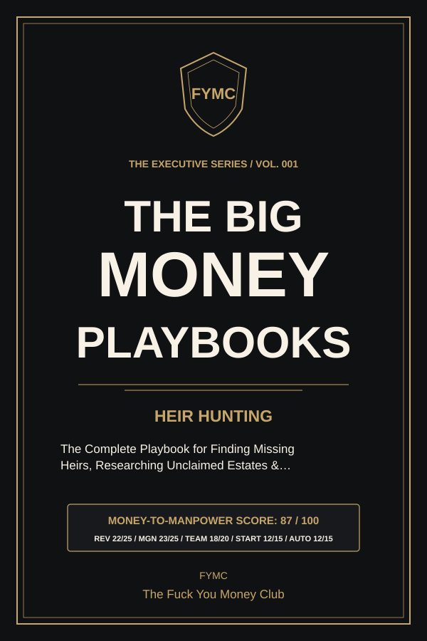 | 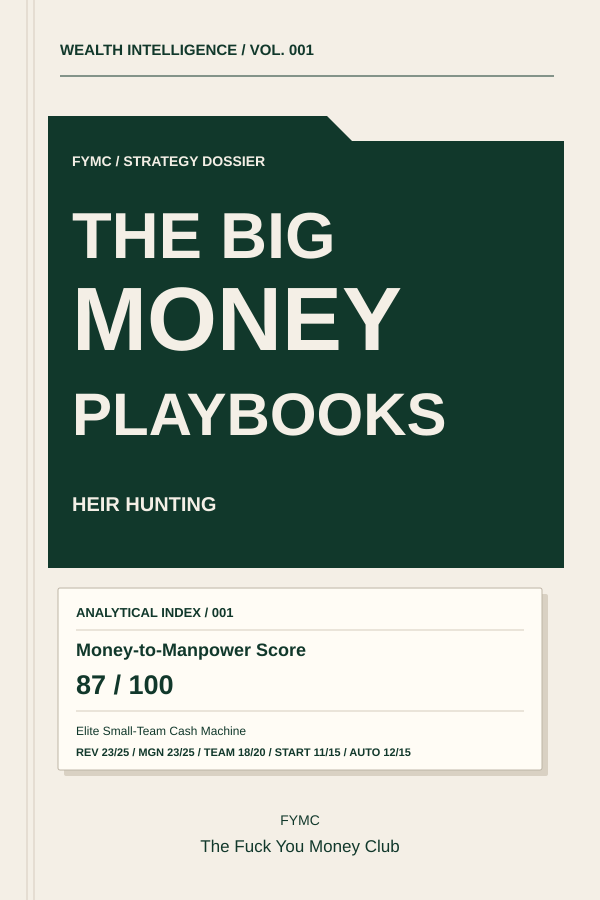 |
| `#09090B` black · `#FFD400` yellow · `#FFFFFF` paper<br>12-col Swiss brutalist magazine grid | `#0B0D11` charcoal · `#C9A45C` gold · `#FAF7F0` cream<br>2-col private-bank marginalia grid | `#F4EFE6` vellum · `#11382B` forest green · `#B68D40` brass<br>3-col Tufte analytical dossier grid |

### Concept B Scorecard & Data-Visualization Plates (Volume 001)

| Money-to-Manpower Scorecard (`87 / 100`) | End-to-End Operating Workflow (`diag_01`) | Contingency Fee Waterfall (`diag_03`) |
| :---: | :---: | :---: |
| 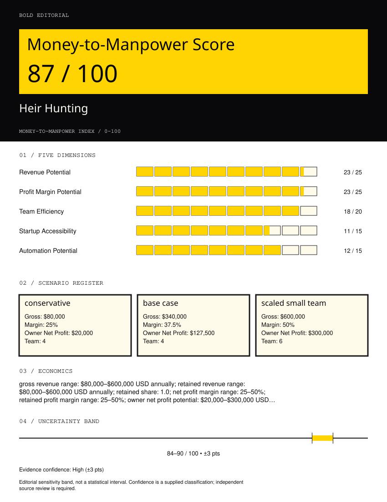 | 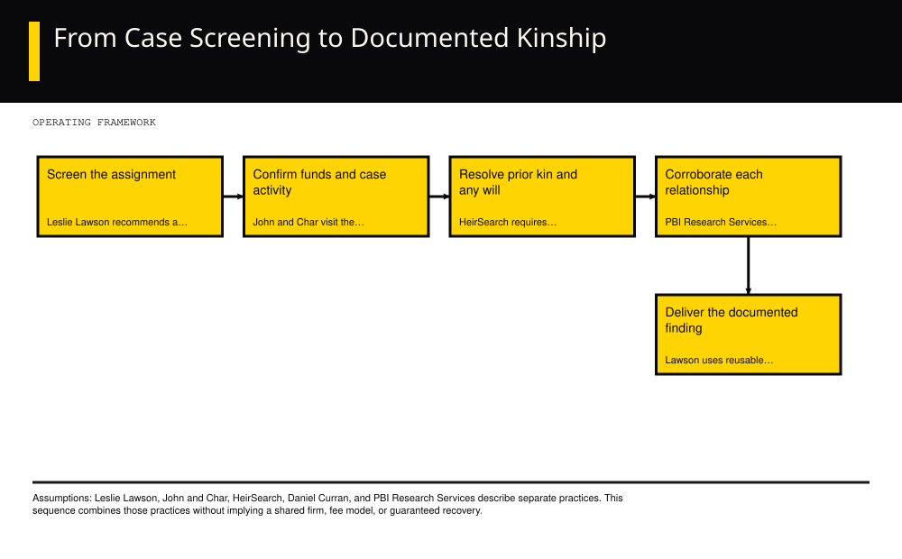 | 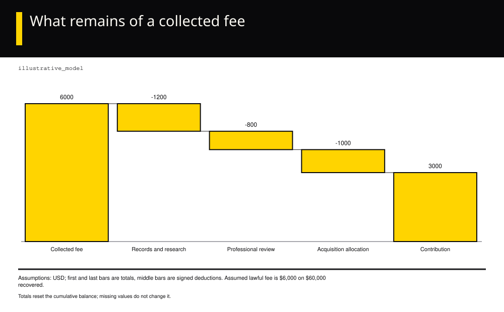 |

### Concept B Cover, Scorecard & Margin Waterfalls (Volumes 002–005)

| Volume 002 Concept B Cover | Volume 002 Scorecard (`86 / 100`) | Fee Waterfall (`diag_03.svg`) |
| :---: | :---: | :---: |
|  | 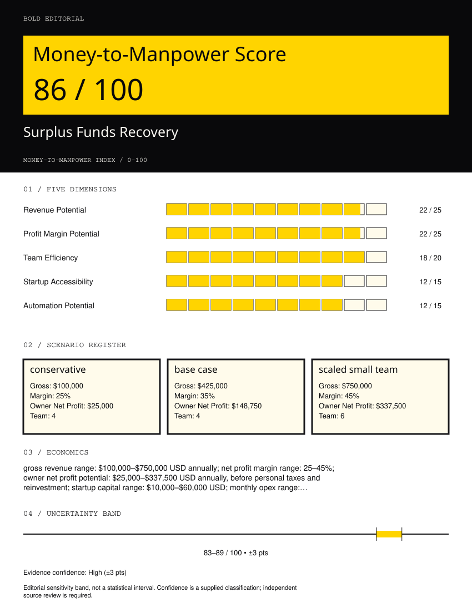 | 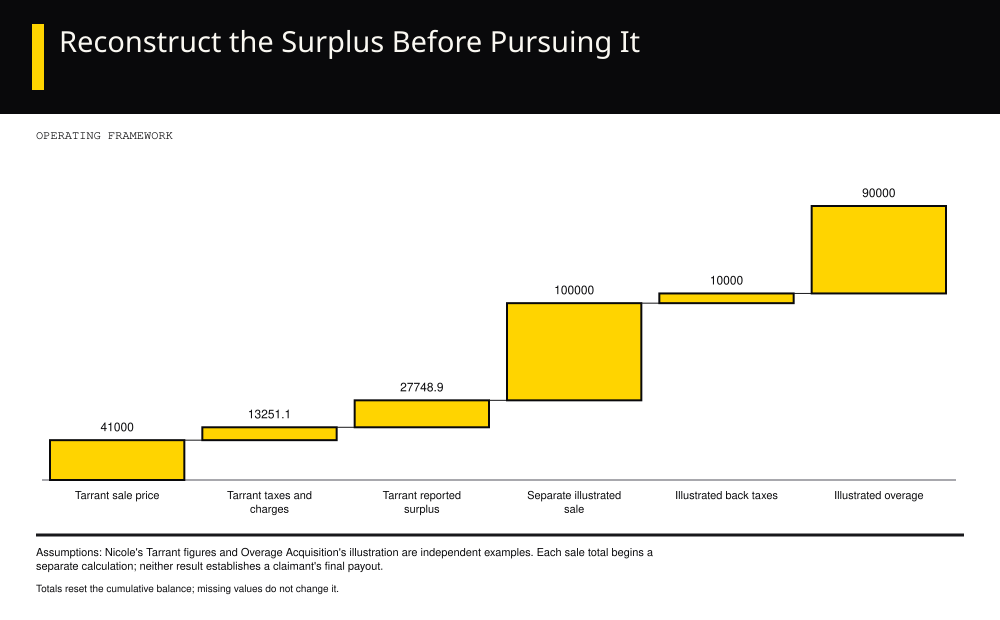 |

| Volume 003 Concept B Cover | Volume 003 Scorecard (`90 / 100`) | SLO Contribution Waterfall (`diag_03.svg`) |
| :---: | :---: | :---: |
|  | 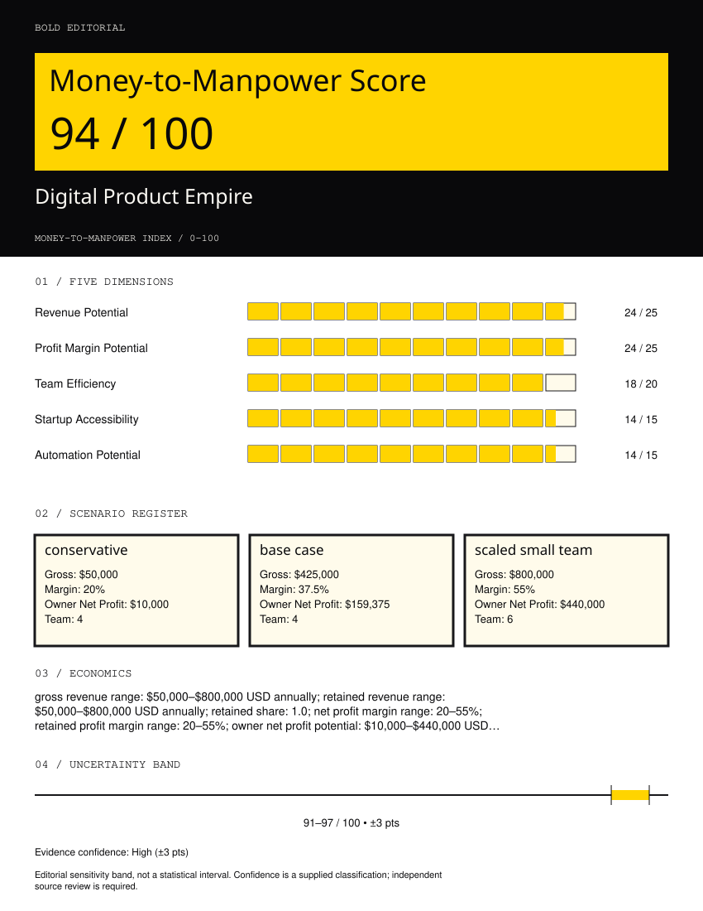 | 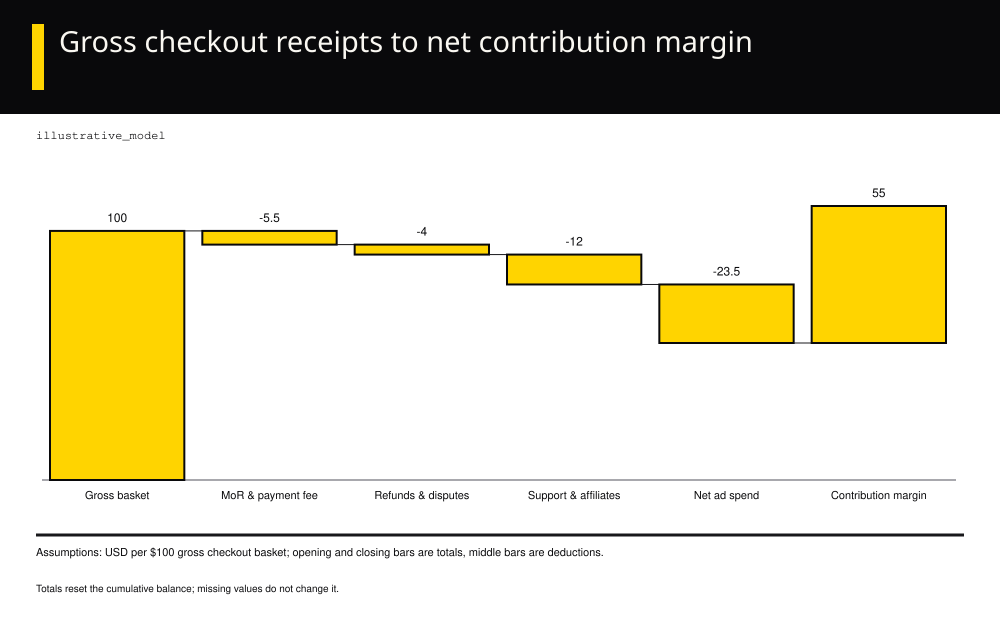 |

| Volume 004 Concept B Cover | Volume 004 Scorecard (`88 / 100`) | MRR-to-Net-Margin Waterfall (`diag_03.svg`) |
| :---: | :---: | :---: |
|  |  | 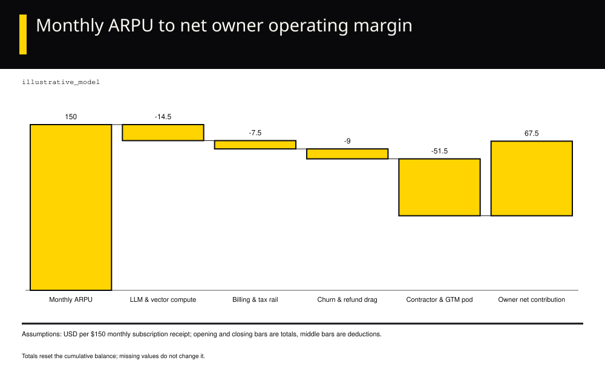 |

| Volume 005 Concept B Cover | Volume 005 Scorecard (`87 / 100`) | EPC-to-Net-Margin Waterfall (`diag_03.svg`) |
| :---: | :---: | :---: |
|  | 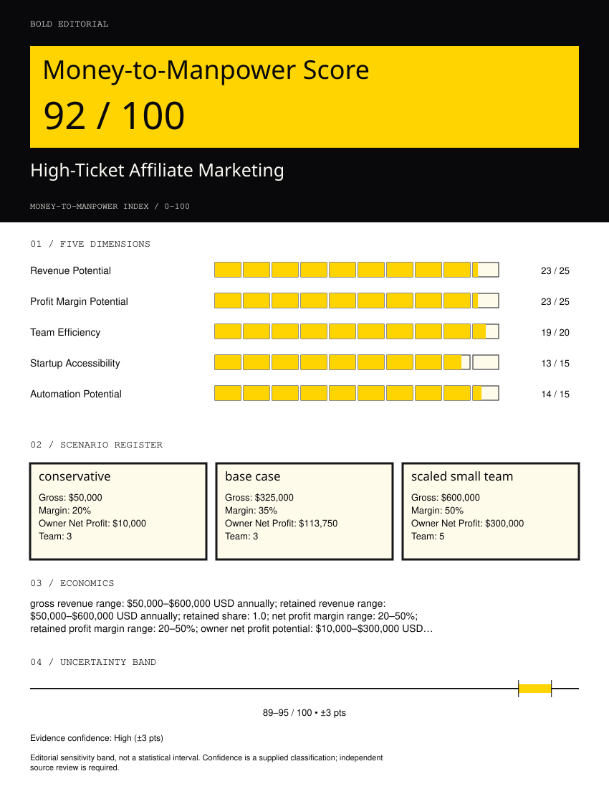 | 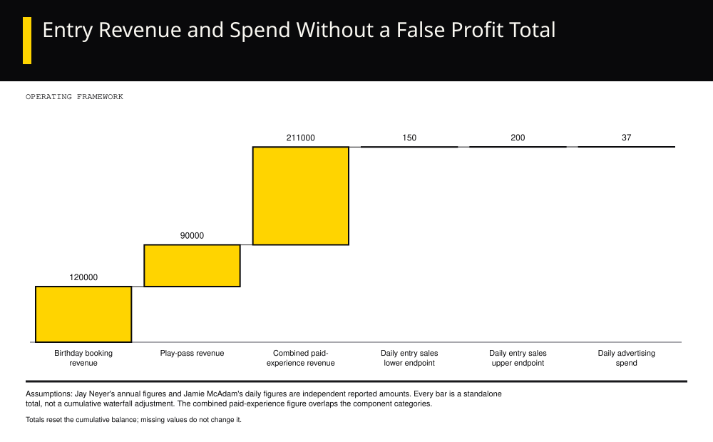 |

---

## 3. Product Suite, Pricing & Print COGS Economics

Configured in [`publishing/brand/brand_system.json`](publishing/brand/brand_system.json) with release gates (`public_deploy_approved: false`, `paid_sales_approved: false`) held closed until launch cutover:

| Offer Tier | Price | Deliverables & Verified Unit Margin Economics |
| :--- | :--- | :--- |
| **Digital Playbook Edition** | **\$29** (\$19–\$39 band) | [8.5×11 Executive Digital PDF](publishing/previews/concept_b/digital_pdf.pdf) + [Reflowable EPUB 3.0](publishing/previews/concept_b/book.epub) + Clickable Source Index (**`97.1%` direct net margin**) |
| **6×9 Print Paperback Edition** | **\$34** | [6×9 Print-Ready PDF](publishing/previews/concept_b/print_6x9_pdf.pdf) (`0.125 in` bleed/trim) · **Spec B** (`78 pp` Standard Color: **\$2.99** KDP COGS, **+\$17.41** KDP net, **+\$28.56** Direct net) · **Spec D** (`280 pp` Expanded B&W: **\$4.36** KDP COGS, **+\$16.04** KDP net, **+\$27.11** Direct net) |
| **Complete Operator Bundle** | **\$79** (\$49–\$99 band) | `6×9` Print Paperback + `8.5×11` Digital PDF + EPUB 3.0 + [6-Worksheet Operator Companion Workbook PDF](publishing/previews/concept_b/workbook_pdf.pdf) ([Complete ZIP](publishing/previews/concept_b/bundle.zip)) |
| **Multi-Volume Founder Collection** | **\$249** (\$199–\$399 band) | 5-Volume Flagship Boxed/Digital Set + 29-Business Money-to-Manpower Atlas + All Companion Workbooks |
| **FYMC Charter Membership** | **\$290/yr** (\$39/mo) | Recurring access to all new Big Money Playbook releases, live 29-business deal scorecards, Track 1/Track 2 arbitrage briefings & operator templates |

---

## 4. Standardized 5-Layer Playbook Architecture (`Q1–Q12`)

Every volume in the 29-book series follows an identical, repeatable 5-layer blueprint ([`src/fymc/volume_001_manuscript.py`](src/fymc/volume_001_manuscript.py), [`src/fymc/interior_templates.py`](src/fymc/interior_templates.py)):

1. **12-Chapter Operating Spine (`Q1–Q12`):**
   * **Ch. 01 (`Q1`):** What Exactly Is the Business? *(Adjacent lanes, boundaries, decision-makers)*
   * **Ch. 02 (`Q2`):** Who Pays, Why They Pay & Where Capital Sits *(Custodians, fee payers, triggers)*
   * **Ch. 03 (`Q3`):** How the Business Makes Money *(Contingency structures, fee caps, unit economics)*
   * **Ch. 04 (`Q4`):** Realistic Startup Requirements *(Working capital, licensing/entity stack, monthly opex)*
   * **Ch. 05 (`Q5`):** What Experienced Operators Know That Beginners Miss *(Asymmetric edge vs. traps)*
   * **Ch. 06 (`Q6`):** Finding Your First Qualified Opportunities *(Dockets, feeds, qualification filters)*
   * **Ch. 07 (`Q7`):** The Complete Operating Process *(Proof standards, math, underwriting)*
   * **Ch. 08 (`Q8`):** Tools, Public Databases & Investigative Stack *(Portals, scrapers, enrichment)*
   * **Ch. 09 (`Q9`):** Outreach, Contracting & Jurisdictional Rules *(Scripts, fee agreements, escrow)*
   * **Ch. 10 (`Q10`):** Automation & AI Leverage *(Scrapers, OCR triage, waterfall routers, walkthrough)*
   * **Ch. 11 (`Q11`):** Small-Team Scaling *(Running a high-margin 2-to-5 person firm)*
   * **Ch. 12 (`Q12`):** The First 30 Days *(Day-by-day execution roadmap)*
2. **Mandatory Expert Evidence Floor (`150–200+` YouTube Deep Links):** Minimum `12` timestamped `[HH:MM:SS]` expert YouTube citations per chapter (`180` clickable deep links in each built volume: [Volume 001 citations](src/fymc/volume_001_citations.py) and [Volume 002 source modules](src/fymc/)).
3. **14 Custom Editorial Layout Plates:** Chapter Opener, Executive Summary, Opportunity Overview, Step-by-Step SOP, Corroborated Expert Insights, Financial Breakdown, Case Study Walkthrough, Comparison Matrix, Research Exhibit, Statutory Notes, Tool Directory, Action Checklist, 30-Day Plan, and Scorecard Plate.
4. **8 Data-Driven Vector Diagrams & 10 Cover/Mockup Assets:** 100% original SVG graphics built from structured JSON ([`src/fymc/diagrams_engine.py`](src/fymc/diagrams_engine.py)).
5. **6 Companion Operator Worksheets:** Intake screens, evidence registers, deal qualification matrices, outreach logs, QC trackers, and 30-day execution sheets.

### Completed Volume 001 — Heir Hunting (`87/100`)

**`vol-001-heir-hunting` is upgraded to the full 5-Layer FYMC Content Structure.** All **12 deep `Q1–Q12` chapters** contain **>=1,250 body prose words per chapter** in `sections[].paragraphs`, with all **5 mapped Track 01 operator plays** and forensic **naive-trap vs durable-operator fallback matrices integrated directly into the chapters**. Conservative/Base/Scaled unit economics sit alongside **180 clickable `[HH:MM:SS]` expert YouTube deep links**, **8 vector diagrams**, **10 cover/mockup SVGs**, and **6 printable worksheets**.

The five mapped plays are `public_record_api_intelligence`, `unclaimed_property_escheatment_arbitrage`, `probate_docket_inheritance_arbitrage`, `forced_pooling_mineral_lease_curve_jumping`, and `fractional_heir_share_partition_forcing`.

Sources and deliverables: [manuscript module](src/fymc/volume_001_manuscript.py), [structured volume package](publishing/volumes/vol-001-heir-hunting/), and [Concept B preview/export package](publishing/previews/concept_b/).

### Completed Volume 002 — Surplus Funds Recovery (`86/100`)

**10/10 Expanded Edition — 100% Built & QA-Verified** — **`vol-002-surplus-funds-recovery`**, *The Complete Playbook for Tax-Sale Overages, Foreclosure Excess Proceeds & Building a Contingent Recovery Firm*, is complete across `src/fymc/vol002_*.py` and `src/fymc/volume_002_*.py` ([source modules](src/fymc/)), [`publishing/volumes/vol-002-surplus-funds-recovery/`](publishing/volumes/vol-002-surplus-funds-recovery/), and [`publishing/previews/vol-002-surplus-funds-recovery/concept_b/`](publishing/previews/vol-002-surplus-funds-recovery/concept_b/).

The full 5-Layer package includes **12 deep `Q1–Q12` chapters** (**`2,023–2,173` body paragraph prose words per chapter**, **`62,159` total words**), post-*Tyler v. Hennepin County* (`598 U.S. 631`) Fifth Amendment statutory tax-sale equity regimes, a **20-State Surplus Operator Target Matrix**, verbatim clerk balance-verification & FOIA templates, ABA Model Rule 5.4 attorney co-counsel structures, cold-call objection scripts, all **10 mapped Track 01 + Track 02 operator plays with forensic teardowns** and naive-trap vs durable-operator fallback matrices integrated into the chapters and worksheets, **202 unique corpus-verified clickable `[HH:MM:SS]` surplus-native YouTube deep links** (`216` sentence-clean citations across `94` surplus videos and `40` channels mined from the `261`-video expanded corpus: `189` core + `72` dedicated surplus transcripts in [`data/custom/vol002_surplus_funds_corpus.json`](data/custom/vol002_surplus_funds_corpus.json)), **8 vector diagrams**, **10 `VOLUME 002` cover/mockup SVGs**, **6 Surplus Funds companion worksheets**, and Owner-Approved Concept B exports (`183`-page Digital PDF, `278`-page `6×9` Print PDF, `97`-page Workbook PDF, EPUB 3.0, and Bundle ZIP). Multi-volume switching is available in both **`/studio` and `/site`**.

The ten mapped plays (`Track 01 + Track 02`) are `public_record_api_intelligence`, `distressed_asset_recovery`, `unclaimed_property_escheatment_arbitrage`, `probate_docket_inheritance_arbitrage`, `property_tax_assessment_appeal_contingency`, `hoa_super_lien_tax_deed_redemption_arbitrage`, `public_filing_trigger_mail_arbitrage`, `identity_graph_pixel_arbitrage`, `competitor_intent_comparison_hijacking`, and `social_to_search_ping_post_arbitrage`.

### Completed Volume 003 — Digital Product Empire (`90/100`, Rank `#01` Overall)

**10/10 Edition — 100% Built & QA-Verified** — **`vol-003-digital-product-empire`**, *The Complete Playbook for High-Margin Templates, Self-Liquidating Funnels, Merchant-of-Record Checkout & Scaling an \$800k/yr 4-Person Catalog*, is complete across `src/fymc/vol003_*.py` and [`src/fymc/volume_003_manuscript.py`](src/fymc/volume_003_manuscript.py), [`publishing/volumes/vol-003-digital-product-empire/`](publishing/volumes/vol-003-digital-product-empire/), and [`publishing/previews/vol-003-digital-product-empire/concept_b/`](publishing/previews/vol-003-digital-product-empire/concept_b/).

The full 5-Layer package includes **12 deep `Q1–Q12` chapters** (**`1,903–2,172` body paragraph prose words per chapter**, **`59,252` total words**), Merchant-of-Record (`Paddle` / `Lemon Squeezy`) vs direct `Stripe` + *South Dakota v. Wayfair* (`585 U.S. 162`) / EU VAT compliance, Self-Liquidating Offer (`SLO`) & SparkLoop co-registration waterfalls, Visa `CE 3.0` chargeback defense, `15 U.S.C. § 8403` ROSCA click-to-cancel & `17 U.S.C. § 512(c)` DMCA templates, `GEO` citation seeding, `Web2App` external web checkout, all **25 mapped Track 01 + Track 02 operator plays with forensic teardowns**, **202 unique corpus-verified clickable `[HH:MM:SS]` YouTube deep links** (`216` sentence-clean citations across `72` videos and `63` channels mined from **75 newly harvested digital-product transcripts** in [`data/custom/vol003_digital_product_corpus.json`](data/custom/vol003_digital_product_corpus.json); `336` total corpus videos), **8 vector diagrams**, **10 `VOLUME 003` cover/mockup SVGs**, **6 Digital Product companion worksheets**, and Owner-Approved Concept B exports (`176`-page Digital PDF, `267`-page `6×9` Print PDF, `92`-page Workbook PDF, EPUB 3.0, and Bundle ZIP). Three-volume switching is live in both **`/studio` and `/site`**.

The twenty-five mapped plays (`Track 01 + Track 02`) are `public_filing_trigger_mail_arbitrage`, `chrome_extension_contextual_arbitrage`, `viral_distribution_loops`, `high_velocity_dm_outbound_systems`, `identity_graph_pixel_arbitrage`, `ad_library_spend_velocity_arbitrage`, `reddit_quora_aged_thread_injection`, `expired_chrome_extension_acquisitions`, `llm_citation_geo_poisoning`, `youtube_faceless_high_cpc_compilation_arbitrage`, `newsletter_co_reg_sparkloop_arbitrage`, `expired_podcast_rss_redirect_arbitrage`, `pinterest_flipboard_visual_serp_arbitrage`, `cloud_ai_startup_credit_aggregation_arbitrage`, `free_llc_fintech_bounty_stacking`, `serverless_edge_free_tier_empire_hosting`, `free_trial_concierge_cpa_arbitrage`, `sportsbook_promo_ev_matched_betting_syndicates`, `verified_fan_ticketing_and_drop_allocation_farming`, `airdrop_points_sybil_cluster_farming`, `parasitic_free_publishing_account_serp_monopoly`, `tier1_search_feed_afd_rsoc_arbitrage`, `ctv_mfa_programmatic_supply_arbitrage`, `copyright_phash_reverse_image_statutory_settlement`, and `web2app_quiz_subscription_billing_bypass`.

### Completed Volume 004 — AI-Powered Micro SaaS (`88/100`, Rank `#02` Overall)

**10/10 Expanded Edition — 100% Built & QA-Verified** — **`vol-004-ai-powered-micro-saas`**, *The Complete Playbook for Vertical B2B Wedges, Token Metering, Cloud-Credit Stacks & Scaling a \$700k ARR 3-to-5 Person Software Firm*, is complete across `src/fymc/vol004_*.py` and [`src/fymc/volume_004_manuscript.py`](src/fymc/volume_004_manuscript.py), [`publishing/volumes/vol-004-ai-powered-micro-saas/`](publishing/volumes/vol-004-ai-powered-micro-saas/), and [`publishing/previews/vol-004-ai-powered-micro-saas/concept_b/`](publishing/previews/vol-004-ai-powered-micro-saas/concept_b/).

The full 5-Layer package includes **12 deep `Q1–Q12` chapters** (**`1,911–2,380` body paragraph prose words per chapter**, **`63,632` total words**, `217` rows across `34` structured tables), a **15-Vertical B2B AI Micro-SaaS Wedge Scorecard Matrix**, an **8-Rail B2B Billing, Embedded Fintech & Global Tax Comparison Matrix**, a **12-Program Cloud, GPU & LLM Startup Credit Grant Directory**, a runnable **Postgres `FORCE ROW LEVEL SECURITY` + Atomic Token-Budget Engineering Blueprint**, verbatim **Enterprise Zero-Data-Retention (`ZDR`) DPA, Liability-Cap & `17 U.S.C. § 204(a)` IP Clauses**, `15 U.S.C. § 8403` ROSCA cancellation flows, diagnostic-scanner outbound scripts, `4x–6x ARR` exit-readiness ledgers, all **27 mapped Track 01 + Track 02 operator plays with forensic teardowns**, **201 unique corpus-verified clickable `[HH:MM:SS]` YouTube deep links** (`216/216` 100% pure SaaS/AI/Billing/Growth sentence-clean citations across `99` videos and `85` channels mined from **105 dedicated AI Micro-SaaS transcripts** in [`data/custom/vol004_ai_micro_saas_corpus.json`](data/custom/vol004_ai_micro_saas_corpus.json); `441` total corpus videos), **8 vector diagrams**, **10 `VOLUME 004` cover/mockup SVGs**, **6 expanded AI Micro-SaaS companion worksheets** (`5,389` words across `60` fields), and Owner-Approved Concept B exports (`197`-page Digital PDF, `303`-page `6×9` Print PDF, `97`-page Workbook PDF, EPUB 3.0, and Bundle ZIP). Four-volume switching is live in both **`/studio` and `/site`**.

The twenty-seven mapped plays (`Track 01 + Track 02`) are `public_record_api_intelligence`, `competitor_intent_comparison_hijacking`, `chrome_extension_contextual_arbitrage`, `viral_distribution_loops`, `identity_graph_pixel_arbitrage`, `saas_technographic_churn_pixel_scraping`, `review_gating_reputation_extortion_funnels`, `ssl_ada_wcag_compliance_scanner_outbound`, `reddit_quora_aged_thread_injection`, `expired_chrome_extension_acquisitions`, `llm_citation_geo_poisoning`, `youtube_faceless_high_cpc_compilation_arbitrage`, `cloud_ai_startup_credit_aggregation_arbitrage`, `free_tier_api_waterfall_multiplexing`, `serverless_edge_free_tier_empire_hosting`, `sportsbook_promo_ev_matched_betting_syndicates`, `platform_privilege_tier_account_arbitrage`, `airdrop_points_sybil_cluster_farming`, `ctv_mfa_programmatic_supply_arbitrage`, `telecom_voice_traffic_pumping_8yy_sms_arbitrage`, `mvno_lifeline_acp_telecom_subsidy_aggregation`, `section_340b_contract_pharmacy_spread_arbitrage`, `b2b_commercial_vcc_interchange_rebate_arbitrage`, `high_risk_payfac_iso_mid_cascading_arbitrage`, `copyright_phash_reverse_image_statutory_settlement`, `web2app_quiz_subscription_billing_bypass`, and `tcpa_litigator_scrub_honeypot_arbitrage`.

### Completed Volume 005 — High-Ticket Affiliate Marketing (`87/100`, Rank `#04` Overall)

**10/10 Expanded Edition — 100% Built & QA-Verified** — **`vol-005-high-ticket-affiliate-marketing`**, *The Complete Playbook for Recurring B2B Software Shares, Stacked Fintech CPA Bounties, S2S Attribution & Scaling a \$600k/yr 3-to-5 Person Referral Portfolio*, completes the **5-Volume Founder Collection Shelf** across `src/fymc/vol005_*.py` and [`src/fymc/volume_005_manuscript.py`](src/fymc/volume_005_manuscript.py), [`publishing/volumes/vol-005-high-ticket-affiliate-marketing/`](publishing/volumes/vol-005-high-ticket-affiliate-marketing/), and [`publishing/previews/vol-005-high-ticket-affiliate-marketing/concept_b/`](publishing/previews/vol-005-high-ticket-affiliate-marketing/concept_b/).

The full 5-Layer package includes **12 deep `Q1–Q12` chapters** (**`2,054–2,155` body paragraph prose words per chapter**, **`70,333` total words**, `422` rows across `48` named-program operator matrices at `6.24` avg words/cell, plus **12 in-chapter `INSIDER PRO-TIPS` callouts** delivering **48 practitioner tactics**), a **20-Category High-Ticket Recurring SaaS, Fintech & Ping-Post Offer Matrix**, an **8-Rail Affiliate Attribution, Sub-Network & Pay-Per-Call Comparison Matrix**, a **Reversal-Adjusted EPC, Net-60 Working-Capital Float & Margin Waterfall**, a **12-Layer Zero-Idle Edge Hosting, S2S Tracker & Call-Routing Stack**, a runnable **Production Cloudflare Worker + D1 S2S Redirect & Constant-Time HMAC Postback Reference** (`click_ledger` + WebCrypto `HMAC-SHA256` + atomic `env.DB.batch` `capi_outbox` + `v_settled_tx` reversal view + `scheduled()` cron & singleton `DurableObject` outbox actor + **Worked 90-Day Cohort Walk**), verbatim **Affiliate Manager Approval & Private 25%-CPA-Bump Scripts**, verbatim **FTC `16 CFR Part 255`, Authorized TM+ Brand-Bidding & TCPA `47 U.S.C. § 227` Consent Templates**, `42 U.S.C. § 1320a-7b(b)` Anti-Kickback & `47 CFR Part 54` Lifeline red-line screens, `<=25%` single-merchant concentration caps, `30x–45x` monthly profit exit diligence, all **35 mapped Track 01 + Track 02 operator plays with forensic teardowns**, **214 unique corpus-verified clickable `[HH:MM:SS]` YouTube deep links across 189 distinct videos and 141 channels** (`216/216` 100% pure Affiliate/SEO/GEO/Attribution sentence-clean citations mined from **195 dedicated High-Ticket Affiliate transcripts** / `1,850` pro tips in [`data/custom/vol005_affiliate_marketing_corpus.json`](data/custom/vol005_affiliate_marketing_corpus.json); `636` total corpus videos), **8 vector diagrams**, **10 `VOLUME 005` cover/mockup SVGs**, **6 expanded High-Ticket Affiliate companion worksheets** (`6,195` words across `60` fields), and Owner-Approved Concept B exports (`218`-page Digital PDF, `339`-page `6×9` Print PDF, `97`-page Workbook PDF, EPUB 3.0, and Bundle ZIP). Five-volume switching is live in both **`/studio` and `/site`**.

The thirty-five mapped plays (`Track 01 + Track 02`) are `parasitic_seo`, `competitor_intent_comparison_hijacking`, `high_velocity_affiliate_funnels`, `social_to_search_ping_post_arbitrage`, `chrome_extension_contextual_arbitrage`, `high_velocity_dm_outbound_systems`, `serp_signal_navboost_engineering`, `identity_graph_pixel_arbitrage`, `paid_to_organic_media_arbitrage`, `ad_library_spend_velocity_arbitrage`, `typo_squatting_brand_bid_hijacking`, `reddit_quora_aged_thread_injection`, `expired_chrome_extension_acquisitions`, `llm_citation_geo_poisoning`, `youtube_faceless_high_cpc_compilation_arbitrage`, `newsletter_co_reg_sparkloop_arbitrage`, `expired_podcast_rss_redirect_arbitrage`, `coupon_checkout_tab_under_injection`, `pinterest_flipboard_visual_serp_arbitrage`, `job_board_xml_feed_programmatic_arbitrage`, `domain_drop_catch_backlink_parking_arbitrage`, `free_llc_fintech_bounty_stacking`, `serverless_edge_free_tier_empire_hosting`, `free_trial_concierge_cpa_arbitrage`, `sportsbook_promo_ev_matched_betting_syndicates`, `aged_high_karma_social_account_brokerage`, `parasitic_free_publishing_account_serp_monopoly`, `tier1_search_feed_afd_rsoc_arbitrage`, `ctv_mfa_programmatic_supply_arbitrage`, `telecom_voice_traffic_pumping_8yy_sms_arbitrage`, `mvno_lifeline_acp_telecom_subsidy_aggregation`, `out_of_network_dme_telehealth_billing_arbitrage`, `high_risk_payfac_iso_mid_cascading_arbitrage`, `web2app_quiz_subscription_billing_bypass`, and `agency_ad_spend_card_multiplier_rebate_cycling`.


### Completed Expansion Volumes (`006–029` Marathon Ledger)

| Volume | Playbook Title (Rank & Score) | Total Words (Prose/Ch) | Operator Matrices | Insider Pro-Tips | Verified YouTube Evidence | Plays | Concept B Exports & Workbook |
| :--- | :--- | :--- | :--- | :--- | :--- | :--- | :--- |
| **Vol. 006** | **Productized AI Agencies** (`#006`, `86/100`) | `76,030` (`2,258–2,508`/ch) | `48` tables / `323` rows (`10.35` w/cell) | `48` (`12` callouts) | `180` links / `162` videos (`178` harvested) | `23` plays | `227`p Dig / `364`p Print / `85`p WB (`7,095`w) |
| **Vol. 007** | **Unclaimed Property Recovery** (`#007`, `85/100`) | `75,914` (`2,259–2,457`/ch) | `48` tables / `371` rows (`10.01` w/cell) | `48` (`12` callouts) | `180` links / `178` videos (`178` harvested) | `12` plays | `225`p Dig / `367`p Print / `85`p WB (`7,175`w) |
| **Vol. 008** | **Commercial Lead Generation** (`#008`, `85/100`) | `77,918` (`2,239–2,531`/ch) | `48` tables / `335` rows (`11.05` w/cell) | `48` (`12` callouts) | `180` links / `153` videos (`178` harvested) | `54` plays | `231`p Dig / `376`p Print / `85`p WB (`7,142`w) |
| **Vol. 009** | **Million-Dollar Lead Generation** (`#009`, `82/100`) | `76,014` (`2,272–2,512`/ch) | `48` tables / `327` rows (`10.54` w/cell) | `48` (`12` callouts) | `180` links / `178` videos (`178` harvested) | `30` plays | `227`p Dig / `369`p Print / `85`p WB (`6,868`w) |
| **Vol. 010** | **Building an SEO Empire** (`#010`, `82/100`) | `75,099` (`2,229–2,481`/ch) | `48` tables / `334` rows (`9.91` w/cell) | `48` (`12` callouts) | `180` links / `178` videos (`178` harvested) | `30` plays | `224`p Dig / `362`p Print / `84`p WB (`7,319`w) |
| **Vol. 011** | **High-Ticket Brokerage** (`#011`, `82/100`) | `76,835` (`2,307–2,485`/ch) | `48` tables / `329` rows (`10.93` w/cell) | `48` (`12` callouts) | `180` links / `178` videos (`178` harvested) | `21` plays | `232`p Dig / `378`p Print / `85`p WB (`7,012`w) |
| **Vol. 012** | **Equipment Brokerage** (`#012`, `81/100`) | `76,561` (`2,271–2,509`/ch) | `48` tables / `335` rows (`10.24` w/cell) | `48` (`12` callouts) | `180` links / `178` videos (`178` harvested) | `7` plays | `227`p Dig / `367`p Print / `85`p WB (`7,066`w) |
| **Vol. 013** | **Intellectual Property Licensing** (`#013`, `79/100`) | `75,305` (`2,261–2,444`/ch) | `48` tables / `329` rows (`10.48` w/cell) | `48` (`12` callouts) | `180` links / `178` videos (`178` harvested) | `4` plays | `227`p Dig / `362`p Print / `84`p WB (`6,916`w) |
| **Vol. 014** | **Specialty Finance Brokerage** (`#014`, `79/100`) | `76,558` (`2,269–2,502`/ch) | `48` tables / `326` rows (`10.34` w/cell) | `48` (`12` callouts) | `180` links / `178` videos (`178` harvested) | `29` plays | `226`p Dig / `364`p Print / `85`p WB (`6,627`w) |
| **Vol. 015** | **Judgment Recovery** (`#015`, `77/100`) | `77,362` (`2,282–2,459`/ch) | `48` tables / `355` rows (`10.27` w/cell) | `48` (`12` callouts) | `180` links / `178` videos (`178` harvested) | `15` plays | `232`p Dig / `380`p Print / `84`p WB (`6,913`w) |
| **Vol. 016** | **Probate Real Estate** (`#016`, `76/100`) | `78,084` (`2,290–2,444`/ch) | `48` tables / `367` rows (`10.53` w/cell) | `48` (`12` callouts) | `180` links / `178` videos (`178` harvested) | `11` plays | `230`p Dig / `376`p Print / `84`p WB (`6,768`w) |
| **Vol. 017** | **Domain Investing** (`#017`, `74/100`) | `76,861` (`2,277–2,478`/ch) | `48` tables / `335` rows (`10.72` w/cell) | `48` (`12` callouts) | `180` links / `178` videos (`178` harvested) | `8` plays | `218`p Dig / `351`p Print / `84`p WB (`7,215`w) |
| **Vol. 018** | **Land Flipping** (`#018`, `72/100`) | `77,698` (`2,273–2,539`/ch) | `48` tables / `340` rows (`10.72` w/cell) | `48` (`12` callouts) | `180` links / `178` videos (`178` harvested) | `6` plays | `233`p Dig / `379`p Print / `84`p WB (`6,919`w) |
| **Vol. 019** | **Enterprise Software Reselling** (`#019`, `72/100`) | `77,377` (`2,308–2,487`/ch) | `48` tables / `360` rows (`10.72` w/cell) | `48` (`12` callouts) | `180` links / `178` videos (`178` harvested) | `9` plays | `231`p Dig / `376`p Print / `85`p WB (`7,180`w) |
| **Vol. 020** | **Government Contract Brokering** (`#020`, `70/100`) | `77,441` (`2,238–2,444`/ch) | `48` tables / `344` rows (`10.42` w/cell) | `48` (`12` callouts) | `180` links / `178` videos (`178` harvested) | `7` plays | `234`p Dig / `379`p Print / `85`p WB (`7,221`w) |
| **Vol. 021** | **Automated E-Commerce** (`#021`, `70/100`) | `75,909` (`2,280–2,494`/ch) | `48` tables / `341` rows (`10.60` w/cell) | `48` (`12` callouts) | `180` links / `178` videos (`178` harvested) | `18` plays | `230`p Dig / `371`p Print / `85`p WB (`6,969`w) |
| **Vol. 022** | **Medical Equipment Resale** (`#022`, `64/100`) | `75,959` (`2,229–2,477`/ch) | `48` tables / `341` rows (`9.76` w/cell) | `48` (`12` callouts) | `180` links / `175` videos (`175` harvested) | `3` plays | `225`p Dig / `365`p Print / `85`p WB (`6,869`w) |
| **Vol. 023** | **Mineral Rights** (`#023`, `63/100`) | `77,054` (`2,315–2,538`/ch) | `48` tables / `336` rows (`10.83` w/cell) | `48` (`12` callouts) | `180` links / `175` videos (`175` harvested) | `5` plays | `228`p Dig / `370`p Print / `84`p WB (`7,041`w) |
| **Vol. 024** | **Tax Lien Investing** (`#024`, `62/100`) | `76,601` (`2,296–2,463`/ch) | `48` tables / `322` rows (`10.64` w/cell) | `48` (`12` callouts) | `180` links / `175` videos (`175` harvested) | `4` plays | `230`p Dig / `369`p Print / `84`p WB (`7,168`w) |
| **Vol. 025** | **Freight Brokerage** (`#025`, `62/100`) | `75,197` (`2,267–2,482`/ch) | `48` tables / `338` rows (`10.19` w/cell) | `48` (`12` callouts) | `180` links / `175` videos (`175` harvested) | `8` plays | `221`p Dig / `352`p Print / `84`p WB (`7,206`w) |

### Built-Volume Unit Economics

Annual illustrative operating scenarios distinguish gross revenue from owner net profit. `FT` means full-time staff; `C` means recurring contractors. Volume 001 scores **87/100** (`22/23/18/12/12`); Volume 002 scores **86/100** (`22/22/18/12/12`); Volume 003 scores **90/100** (`22/23/19/12/14`); Volume 004 scores **88/100** (`22/22/19/11/14`); Volume 005 scores **87/100** (`21/22/19/12/13`). All five built Founder Collection volumes have **±3-point sensitivity, High confidence**.

| Volume | Scenario | Gross Revenue | Owner Net Margin | Owner Net Profit | Team |
| :--- | :--- | ---: | ---: | ---: | :--- |
| 001 — Heir Hunting | Conservative | \$80,000 | 25% | \$20,000 | 1 FT + 3 C |
| 001 — Heir Hunting | Base | \$340,000 | 37.5% | \$127,500 | 1 FT + 3 C |
| 001 — Heir Hunting | Scaled | \$600,000 | 50% | \$300,000 | 2 FT + 4 C |
| 002 — Surplus Funds Recovery | Conservative | \$100,000 | 25% | \$25,000 | 2 FT + 2 C |
| 002 — Surplus Funds Recovery | Base | \$425,000 | 35% | \$148,750 | 2 FT + 2 C |
| 002 — Surplus Funds Recovery | Scaled | \$750,000 | 45% | \$337,500 | 3 FT + 3 C |
| 003 — Digital Product Empire | Conservative | \$50,000 | 20% | \$10,000 | 1 FT + 3 C |
| 003 — Digital Product Empire | Base | \$425,000 | 37.5% | \$159,375 | 1 FT + 3 C |
| 003 — Digital Product Empire | Scaled | \$800,000 | 55% | \$440,000 | 2 FT + 4 C |
| 004 — AI-Powered Micro SaaS | Conservative | \$50,000 | 15% | \$7,500 | 1 FT + 2 C |
| 004 — AI-Powered Micro SaaS | Base | \$375,000 | 30% | \$112,500 | 1 FT + 2 C |
| 004 — AI-Powered Micro SaaS | Scaled | \$700,000 | 45% | \$315,000 | 2 FT + 3 C |
| 005 — High-Ticket Affiliate Marketing | Conservative | \$50,000 | 20% | \$10,000 | 1 FT + 2 C |
| 005 — High-Ticket Affiliate Marketing | Base | \$325,000 | 35% | \$113,750 | 1 FT + 2 C |
| 005 — High-Ticket Affiliate Marketing | Scaled | \$600,000 | 50% | \$300,000 | 2 FT + 3 C |

### Chapter Records & Production State

Each chapter uses the strict shared record schema: `id`, `chapter_id`, `chapter_number`, `question_number`, `slug`, `question_prompt`, `kicker`, `title`, `subtitle`, `layout_template`, `reading_time_minutes`, `executive_summary`, `key_metrics`, `sections`, `pull_quote`, `diagram_id`, `action_checklist`, and `statutory_citations`. Content stays in the structured sections rather than flat chapter overrides. Each chapter has a 70–110-word executive summary, a 12-minute reading-time field, 4–5 sections of 3–4 concrete paragraphs, at least two tables, one SOP, and one operator callout. Section evidence is labeled `statutory_fact`, `operating_framework`, `illustrative_model`, or `attributed_practitioner_claim`.

Of the **12 workflow stages**, stages **1–11** — Research, Source Review, Editorial Outline, Manuscript, Fact-Checking, Design, Graphics, Scorecard, Proofreading, Export, and Quality Assurance — have `status="completed"`. Stage **12 — Publication Approval** has `status="staged_preview"`. These completed deliverables remain staged previews, not public deployment or paid-sales authorization.

---

## 5. Phased Execution & Omnichannel Rollout Roadmap

* **Phase 1 — Foundation, Owner-Approved Series Master & Upgraded Volume 001 *(COMPLETE)*:**
  * 189-video corpus (`79.95` hours, `812,038` raw segment words, `1,806` scored pro tips) indexed in [`data/`](data).
  * **Concept B (`concept_b` — Bold Editorial)** locked as **Owner-Approved Series Master**; all **29 candidate volumes** and **97 canonical operator plays (56 Track 01 + 41 Track 02)** retained.
  * **Volume 001 — Heir Hunting (`87/100`)** upgraded to the full 5-Layer structure: 12 deep chapters, all 5 mapped plays and forensic fallback matrices, 180 expert deep links, 8 vector diagrams, 10 cover/mockup SVGs, and 6 worksheets in the [volume package](publishing/volumes/vol-001-heir-hunting/) and [Concept B exports](publishing/previews/concept_b/).
* **Phase 2 — Initial 5-Volume Founder Collection Shelf *(COMPLETE)*:**
  * **Volume 002 — Surplus Funds Recovery (`86/100`)**, **Volume 003 — Digital Product Empire (`90/100`, Rank `#01` Overall)**, **Volume 004 — AI-Powered Micro SaaS (`88/100`, Rank `#02` Overall)**, and **Volume 005 — High-Ticket Affiliate Marketing (`87/100`, Rank `#04` Overall)** are **100% Built & QA-Verified** at `10/10` depth across `636` total corpus videos (`189` core + `72` surplus + `75` digital-product + `105` AI Micro-SaaS + `195` High-Ticket Affiliate transcripts; `5,991` pro tips), with 5-volume switching live in both `/studio` and `/site`.
  * Volumes `001–006` are **100% Built & QA-Verified** (`814` total corpus videos); next in rank order: **Volume 007 — Unclaimed Property Recovery**.
* **Phase 3 — Public Launch, Checkout & 4-Channel Distribution *(GATED ON OWNER LAUNCH APPROVAL)*:**
  * Connect production domain + live Stripe checkout on `/site` (`84–97%` direct net margin + \$290/yr Charter Memberships).
  * Distribute `marketplace_clean` editions across **Amazon KDP** (`6×9` Print + Kindle), **Etsy** (Digital Playbook + Printable Workbook bundles), and **eBay** (Collector print + bundle packs).
* **Phase 4 — Full 29-Volume Rollout & Recurring Club Engine:**
  * Ship all 29 volumes systematically while publishing live deal scorecards and Track 1/Track 2 operator briefings to Charter Members and *Operator Dispatch* subscribers.

---

## 6. All 29 Scored Candidate Playbook Volumes (`#01`–`#29`)

Source of truth: [`publishing/catalog/pipeline_29_candidates.json`](publishing/catalog/pipeline_29_candidates.json). Sub-scores represent `Rev(25)/Mgn(25)/Team(20)/Start(15)/Auto(15)`.

| Rank | Candidate Title | Category | Score (Band) | Sub-Scores | Team | Annual Gross Revenue | Owner Net Profit Range | Tracks | Plays |
| :--- | :--- | :--- | :--- | :--- | :--- | :--- | :--- | :--- | :--- |
| **#01** | **Digital Product Empire** *(Vol. 003 Built & QA-Verified)* | Digital education & tools | **90/100** (`±3` High) | `22/23/19/12/14` | 4 (`1 FT + 3 C`) | \$50k–\$800k | \$10,000–\$440,000 | T1, T2 | `25` |
| **#02** | **AI-Powered Micro SaaS** *(Vol. 004 Built & QA-Verified)* | Subscription software | **88/100** (`±3` High) | `22/22/19/11/14` | 3 (`1 FT + 2 C`) | \$50k–\$700k | \$7,500–\$315,000 | T1, T2 | `27` |
| **#03** | **Heir Hunting** *(Vol. 001 Flagship)* | Estate research | **87/100** (`±3` High) | `22/23/18/12/12` | 4 (`1 FT + 3 C`) | \$80k–\$600k | \$20,000–\$300,000 | T1 | `5` |
| **#04** | **High-Ticket Affiliate Marketing** *(Vol. 005 Built & QA-Verified)* | Referral publishing | **87/100** (`±3` High) | `21/22/19/12/13` | 3 (`1 FT + 2 C`) | \$50k–\$600k | \$10,000–\$300,000 | T2, T1 | `35` |
| **#05** | **Surplus Funds Recovery** *(Vol. 002 Built & QA-Verified)* | Recovery services | **86/100** (`±3` High) | `22/22/18/12/12` | 4 (`2 FT + 2 C`) | \$100k–\$750k | \$25,000–\$337,500 | T1, T2 | `10` |
| **#06** | **Productized AI Agencies** *(Vol. 006 Built & QA-Verified)* | Tech implementation | **86/100** (`±10` Prelim) | `23/21/17/12/13` | 5 (`2 FT + 3 C`) | \$100k–\$1.0M | \$20,000–\$400,000 | T1, T2 | `23` |
| **#07** | **Unclaimed Property Recovery** *(Vol. 007 Built & QA-Verified)* | Recovery services | **85/100** (`±3` High) | `20/22/18/13/12` | 3 (`1 FT + 2 C`) | \$60k–\$450k | \$15,000–\$225,000 | T1 | `12` |
| **#08** | **Commercial Lead Generation** *(Vol. 008 Built & QA-Verified)* | B2B marketing services | **85/100** (`±6` Mod) | `21/21/18/12/13` | 4 (`1 FT + 3 C`) | \$100k–\$750k | \$20,000–\$300,000 | T1, T2 | `54` |
| **#09** | **Million-Dollar Lead Generation** *(Vol. 009 Built & QA-Verified)* | Enterprise demand gen | **82/100** (`±10` Prelim) | `24/21/16/9/12` | 5 (`2 FT + 3 C`) | \$150k–\$1.2M | \$30,000–\$480,000 | T1, T2 | `30` |
| **#10** | **Building an SEO Empire** *(Vol. 010 Built & QA-Verified)* | Search-driven publishing | **82/100** (`±6` Mod) | `22/21/17/10/12` | 6 (`2 FT + 4 C`) | \$80k–\$900k | \$16,000–\$405,000 | T1, T2 | `30` |
| **#11** | **High-Ticket Brokerage** *(Vol. 011 Built & QA-Verified)* | Specialist transactions | **82/100** (`±6` Mod) | `23/22/18/10/9` | 4 (`1 FT + 3 C`) | \$100k–\$1.0M | \$25,000–\$500,000 | T1, T2 | `21` |
| **#12** | **Equipment Brokerage** *(Vol. 012 Built & QA-Verified)* | Industrial brokerage | **81/100** (`±6` Mod) | `22/20/18/11/10` | 4 (`1 FT + 3 C`) | \$100k–\$800k | \$25,000–\$360,000 | T1 | `7` |
| **#13** | **Intellectual Property Licensing** *(Vol. 013 Built & QA-Verified)* | Licensing services | **79/100** (`±10` Prelim) | `22/23/18/6/10` | 4 (`1 FT + 3 C`) | \$50k–\$800k | \$12,500–\$480,000 | T1, T2 | `4` |
| **#14** | **Specialty Finance Brokerage** *(Vol. 014 Built & QA-Verified)* | Finance intermediary | **79/100** (`±6` Mod) | `23/21/17/8/10` | 4 (`2 FT + 2 C`) | \$120k–\$1.0M | \$30,000–\$450,000 | T1, T2 | `29` |
| **#15** | **Judgment Recovery** *(Vol. 015 Built & QA-Verified)* | Recovery services | **77/100** (`±6` Mod) | `20/21/16/10/10` | 4 (`1 FT + 3 C`) | \$60k–\$500k | \$12,000–\$200,000 | T1, T2 | `15` |
| **#16** | **Probate Real Estate** *(Vol. 016 Built & QA-Verified)* | Real estate services | **76/100** (`±3` High) | `23/18/16/9/10` | 5 (`2 FT + 3 C`) | \$120k–\$900k | \$24,000–\$315,000 | T1, T2 | `11` |
| **#17** | **Domain Investing** *(Vol. 017 Built & QA-Verified)* | Digital asset trading | **74/100** (`±6` Mod) | `17/18/19/9/11` | 2 (`1 FT + 1 C`) | \$20k–\$300k | \$3,000–\$120,000 | T1, T2 | `8` |
| **#18** | **Land Flipping** *(Vol. 018 Built & QA-Verified)* | Real estate trading | **72/100** (`±6` Mod) | `21/18/17/6/10` | 4 (`1 FT + 3 C`) | \$200k–\$1.5M | \$24,000–\$375,000 | T1, T2 | `6` |
| **#19** | **Enterprise Software Reselling** *(Vol. 019 Built & QA-Verified)* | Software channel sales | **72/100** (`±6` Mod) | `23/14/15/9/11` | 5 (`2 FT + 3 C`) | \$300k–\$2.5M | \$24,000–\$500,000 | T1, T2 | `9` |
| **#20** | **Government Contract Brokering** *(Vol. 020 Built & QA-Verified)* | Procurement services | **70/100** (`±6` Mod) | `22/16/14/8/10` | 5 (`2 FT + 3 C`) | \$120k–\$1.0M | \$18,000–\$300,000 | T1, T2 | `7` |
| **#21** | **Automated E-Commerce** *(Vol. 021 Built & QA-Verified)* | Online retail | **70/100** (`±6` Mod) | `23/13/14/8/12` | 5 (`2 FT + 3 C`) | \$250k–\$2.0M | \$12,500–\$360,000 | T2, T1 | `18` |
| **#22** | **Medical Equipment Resale** *(Vol. 022 Built & QA-Verified)* | Equipment trading | **64/100** (`±6` Mod) | `21/16/13/6/8` | 6 (`2 FT + 4 C`) | \$250k–\$1.8M | \$25,000–\$396,000 | T1, T2 | `3` |
| **#23** | **Mineral Rights** *(Vol. 023 Built & QA-Verified)* | Resource assets | **63/100** (`±6` Mod) | `20/17/16/3/7` | 4 (`1 FT + 3 C`) | \$30k–\$400k | \$6,000–\$180,000 | T1, T2 | `5` |
| **#24** | **Tax Lien Investing** *(Vol. 024 Built & QA-Verified)* | Asset investing | **62/100** (`±6` Mod) | `17/15/17/5/8` | 3 (`1 FT + 2 C`) | \$15k–\$180k | \$4,500–\$99,000 | T1, T2 | `4` |
| **#25** | **Freight Brokerage** *(Vol. 025 Built & QA-Verified)* | Logistics | **62/100** (`±6` Mod) | `23/10/10/7/12` | 5 (`3 FT + 2 C`) | \$1.0M–\$5.0M | \$30,000–\$400,000 | T1 | `8` |
| **#26** | **Government Surplus Auctions** | Surplus asset trading | **62/100** (`±6` Mod) | `20/14/12/8/8` | 5 (`2 FT + 3 C`) | \$150k–\$1.0M | \$12,000–\$200,000 | T1, T2 | `6` |
| **#27** | **Business Acquisition** | Operating ownership | **57/100** (`±6` Mod) | `24/16/7/2/8` | 10 (`7 FT + 3 C`) | \$750k–\$3.0M | \$60,000–\$540,000 | T1, T2 | `7` |
| **#28** | **Commercial Cleaning Contracts** | Facility services | **56/100** (`±6` Mod) | `21/12/6/11/6` | 9 (`5 FT + 4 C`) | \$250k–\$1.2M | \$20,000–\$192,000 | T1, T2 | `4` |
| **#29** | **Insurance Restoration** | Property restoration | **54/100** (`±6` Mod) | `24/13/5/5/7` | 11 (`5 FT + 6 C`) | \$500k–\$2.5M | \$40,000–\$450,000 | T2, T1 | `5` |

---

## 7. All 97 Canonical Operator Plays (`Track 01` & `Track 02`)

Source of truth: `PLAY_DEFINITIONS` in [`src/fymc/scorecard_engine.py`](src/fymc/scorecard_engine.py) and [`publishing/catalog/pipeline_29_candidates.json`](publishing/catalog/pipeline_29_candidates.json).

### Track 01 — Asymmetric & Data-Arbitrage Plays (`56` Plays)

#### 7.1 Public-Record, Signal-Scraping & Trigger-Filing Arbitrage (`01–26`)

| # | Play ID | Title | Core Arbitrage Mechanism & Economics | Mapped Volumes |
| :--- | :--- | :--- | :--- | :--- |
| 01 | `public_record_api_intelligence` | **Public-Record & API Intelligence** | Ingest fragmented county dockets, probate registries, unclaimed property ledgers, and licensing APIs before manual competitors. | `#02, #03, #05, #07, #08, #15, #16, #20` |
| 02 | `expired_domain_traffic_arbitrage` | **Expired Authority Domain (`.gov`/`.edu`/Media) Rebuilds** | Acquire dropped/auctioned clean backlink domains, rebuild strict topical-continuity hubs, and monetize via high-payout lead routing. | `#10, #17` |
| 03 | `programmatic_seo` | **Programmatic SEO** | Combine proprietary structured datasets (pricing benchmarks, local statutes, calculators) with high-utility page templates. | `#08, #10` |
| 04 | `distressed_asset_recovery` | **Distressed Asset Recovery** | Locate orphaned tax-sale overages, unclaimed state funds, dormant judgments, or surplus lots for contingent fees or spreads. | `#05, #07, #15, #26, #27` |
| 05 | `telegram_channel_signal_scraping` | **Telegram Channel & Deal-Room Signal Scraping** | Ingest public Telegram broadcasts, OTC deal rooms, and wholesale distress feeds in real time without member-scraping bans. | `#06, #08, #09, #11, #12` |
| 06 | `public_filing_trigger_mail_arbitrage` | **New-LLC & Recorded-Deed Trigger-Mail Arbitrage** | Ingest daily SOS new-LLC filings and County Recorder deeds to trigger API direct mail for recurring B2B/tax-appeal offers (replacing prohibited government-lookalike mailers). | `#01, #05, #08, #09, #14, #16, #25` |
| 07 | `newly_registered_domain_trigger_arbitrage` | **Newly Registered Domain (NRD) & DNS-Diagnostic Trigger Mail** | Ingest ICANN CZDS daily zone diffs + `.us` RDAP feeds, cross-match SOS LLC addresses, probe 72h DNS/indexing gaps, and trigger diagnostic mailers. | `#06, #08, #10, #17` |
| 08 | `ego_bait_directory_badge_arbitrage` | **Industry Award & Verified Directory "Ego-Bait" Badge Arbitrage** | Publish data-scored city rankings, issue free embeddable "Top Rated" badges for high-DR backlinks, and upsell \$299–\$799/mo Featured #1 slots. | `#08, #10, #11, #12, #20, #25` |
| 09 | `b2b_class_action_contingency_recovery` | **B2B Class-Action & Antitrust Settlement Contingency Recovery** | Monitor multibillion-dollar corporate antitrust settlements (interchange, freight, SaaS) where 85–90% of SMBs never file; recover on 25–33% contingency. | `#07, #14, #15` |
| 10 | `arizona_abs_mass_tort_cocounsel` | **Arizona ABS Law-Firm Ownership & Survivor/Mass-Tort Co-Counsel** | Leverage Arizona Supreme Court Rule 31.1(c) & ACJA § 7-209 (Alternative Business Structure) so non-lawyer acquisition operators own an AZ law firm, originate institutional sexual assault survivor & mass-tort dockets, and earn \$50k–\$400k+ co-counsel fee splits. | `#08, #09, #11, #14, #15` |
| 11 | `unclaimed_property_escheatment_arbitrage` | **State Treasury Escheatment & Unclaimed Corporate Warrant Recovery** | Ingest state treasury escheatment ledgers & uncashed warrants above \$25k, match corporate officers via SOS filings, and earn 10–25% finder fees. | `#03, #05, #07, #15` |
| 12 | `municipal_code_violation_trigger_arbitrage` | **Municipal Code-Violation, Mechanic's Lien & Permit-Failure Leads** | Poll building departments and county recorders daily for failed fire/structural inspections, citations, and mechanic's liens for exclusive contractor leads. | `#08, #09, #16, #29` |
| 13 | `freight_detention_audit_contingency` | **Automated Parcel, LTL Freight & Tariff Overcharge Auditing** | Ingest UPS/FedEx/LTL EDI feeds and CBP Form 7501 customs summaries via read-only API to claim SLA/dim-weight/duty-drawback refunds at 35–50% contingency. | `#07, #08, #14, #21, #25` |
| 14 | `ucc1_expiration_refi_trigger_arbitrage` | **UCC-1 Filing, MCA Stacking & Maturity-Date Trigger Arbitrage** | Monitor state SOS UCC-1 financing statements to intercept businesses 4–9 months into expensive MCAs/equipment notes for refinance live transfers. | `#08, #09, #11, #14, #15` |
| 15 | `probate_docket_inheritance_arbitrage` | **Probate Docket & Pre-Foreclosure Notice-of-Default (NOD) Scraping** | Parse county probate petitions and daily NOD filings before national aggregators index them, routing out-of-state executors to probate brokers/buyers. | `#03, #05, #16` |
| 16 | `fmcsa_dot_inspection_trigger_arbitrage` | **FMCSA/DOT New-Authority & Roadside Violation Trigger Funnels** | Ingest daily federal FMCSA Census, L&I, and SMS inspection feeds during the mandatory 21-day insurance-filing window or post-citation. | `#08, #12, #14, #25` |
| 17 | `ad_library_spend_velocity_arbitrage` | **Ad-Library Spend-Velocity & Funnel-Clone Arbitrage** | Poll Meta, Google, and TikTok Ad Libraries for creatives sustained `>30` days with expanding variants, localizing proven architectures into new geos/niches. | `#01, #04, #08, #10, #21` |
| 18 | `saas_technographic_churn_pixel_scraping` | **DNS/Script Technographic Drop-Off & Renewal-Window Interception** | Crawl commercial DOM/DNS TXT/CNAME records weekly to detect enterprise tag installs/removals and intercept Month 10–11 contract renewals. | `#02, #06, #08, #09, #19` |
| 19 | `sec_edgar_8k_vendor_trigger_arbitrage` | **SEC Form 8-K, Form D & C-Suite Turnover Trigger Arbitrage** | Parse real-time SEC EDGAR RSS/JSON feeds for Reg D raises and Form 8-K C-suite/M&A events for sub-hour executive outreach. | `#06, #08, #09, #11, #14, #19` |
| 20 | `patent_trademark_office_action_arbitrage` | **USPTO "Office Action" Rejection & Trademark Abandonment Mail** | Poll USPTO TSDR daily XML feeds for unrepresented pro-se applicants receiving Non-Final Office Actions, routing private-attorney referrals. | `#06, #08, #09, #13` |
| 21 | `review_gating_reputation_extortion_funnels` | **Negative-Review Trigger Scraping & Reputation-Defense Arbitrage** | Monitor GBP, Trustpilot, and Yelp across medspas/dental/roofing/auto for new 1-star reviews, pitching TOS-audit & review-velocity retainers. | `#02, #06, #08` |
| 22 | `government_rfp_subcontractor_brokerage` | **SAM.gov / Municipal RFP Scraping & Prime-Subcontractor Spread** | Scrape SAM.gov and municipal bid boards for low-bid-density solicitations, pairing automated proposals with local subcontractors for a 15–30% spread. | `#08, #09, #20, #26` |
| 23 | `hospital_lien_medical_receivables_arbitrage` | **Out-of-Network Medical Claim & ERISA Appeal Contingency Recovery** | Automate federal No Surprises Act IDR and ERISA administrative appeals on underpaid surgical/ambulance claims for a 20–35% contingency fee. | `#07, #14, #15` |
| 24 | `amazon_asin_hijack_brand_protection_trigger` | **Unauthorized 3P Seller / MAP-Violation Scraping & Enforcement** | Monitor Amazon/Walmart/eBay Buy Boxes for MAP violations, sending automated revenue-loss dossiers to close \$2.5k–\$7.5k/mo brand-protection retainers. | `#06, #08, #13, #21` |
| 25 | `property_tax_assessment_appeal_contingency` | **Automated Commercial/Residential Property-Tax Appeal Arbitrage** | Run AVM equity-ratio checks on newly released county tax rolls and file bulk administrative protests for 30–50% of Year-1 tax savings. | `#05, #07, #08, #16` |
| 26 | `ssl_ada_wcag_compliance_scanner_outbound` | **Automated ADA/WCAG Demand-Letter Defense & Scanner Funnels** | Combine headless Axe-core WCAG 2.1 AA DOM audits with PACER ADA lawsuit tracking to close code-level accessibility remediation retainers. | `#02, #06, #08, #21` |

#### 7.2 Free-Compute, Fintech Bounty & Infrastructure Subsidy Plays (`27–30`)

| # | Play ID | Title | Core Arbitrage Mechanism & Economics | Mapped Volumes |
| :--- | :--- | :--- | :--- | :--- |
| 27 | `cloud_ai_startup_credit_aggregation_arbitrage` | **Cloud & LLM Startup Credit Grant Aggregation (\$50k–\$350k)** | Enroll clean micro-SaaS LLCs in verified founder/venture-partner perks (AWS Activate, Azure, GCP, Cloudflare, OpenAI, Anthropic) to run zero-COGS AI products at 90–98% cash margins. | `#01, #02, #06, #08` |
| 28 | `free_llc_fintech_bounty_stacking` | **"Free LLC / Free Setup" Fintech Co-Registration Bounty Stacking** | Offer \$0-fee LLC formation where new entities open business banking, card, payroll, and bookkeeping accounts—stacking \$600–\$1,800+ in B2B fintech CPA bounties per formation. | `#01, #04, #08, #14` |
| 29 | `free_tier_api_waterfall_multiplexing` | **Multi-Provider Free-Tier API Router & Enrichment Reselling** | Multiplex 30–60+ permanent developer free tiers (50–1,000 lookups/mo each) behind a Postgres-cached waterfall router, selling \$99–\$499/mo B2B enrichment at near-zero API COGS. | `#02, #06, #08, #09` |
| 30 | `serverless_edge_free_tier_empire_hosting` | **Zero-COGS 1,000-Site Programmatic Hosting on Free Edge Tiers** | Deploy static programmatic directories, calculators, and lead sites across Cloudflare Pages, GitHub Pages, Vercel, and Netlify at \$0.00/mo hosting/SSL cost. | `#01, #02, #04, #08, #10, #17` |

#### 7.3 Whale-Scale Healthcare, Customs/Tariff, VCC, Legal & Hard-Asset Arbitrage (`31–52`)

| # | Play ID | Title | Core Arbitrage Mechanism & Economics | Mapped Volumes |
| :--- | :--- | :--- | :--- | :--- |
| 31 | `erisa_self_funded_specialty_drug_importation_arbitrage` | **Self-Funded ERISA International Specialty-Drug Importation** | Carve out \$6k–\$15k/mo biologics/GLP-1s for self-funded ERISA employers via Tier-1 Canadian/UK/ANZ pharmacies (\$800–\$2.2k/mo), waiving employee copays and taking 25–35% of \$50k–\$100k/yr per-patient savings. | `#08, #09, #14, #19` |
| 32 | `section_340b_contract_pharmacy_spread_arbitrage` | **340B Contract-Pharmacy & Covered-Entity Drug Spread Arbitrage** | Provide turnkey TPA split-billing & contract-pharmacy fulfillment to HRSA 340B clinics, capturing administrative fees on 25–50%+ statutory drug discounts vs. commercial reimbursement. | `#02, #09, #14, #19` |
| 33 | `out_of_network_dme_telehealth_billing_arbitrage` | **Out-of-Network DME, CGM & Reference Lab Billing Arbitrage** | Operate a healthcare MSO pairing paid-social symptom funnels (\$85–\$220 CAC) with independent telehealth MDs and DME suppliers for \$900–\$3,500+ reimbursed HCPCS codes. | `#04, #08, #09, #14` |
| 34 | `section_321_de_minimis_bonded_tariff_arbitrage` | **Section 321 "De Minimis" & Border Bonded-Warehouse Split-Shipping** | Route bulk container imports to Tijuana (IMMEX) or Canadian border 3PLs and fulfill DTC parcels under 19 U.S.C. § 1321 Entry Type 86, charging 35–50% of eliminated 15–42.5% tariffs. | `#19, #21, #25, #26` |
| 35 | `authorized_distributor_grey_market_diversion_arbitrage` | **Authorized-Distributor "Diversion" & First-Sale Grey-Market Imports** | Source authentic branded luxury/medical consumables from over-quota EMEA/LATAM distributors at 35–60% regional discounts and import into US off-price/Amazon wholesale under *Kirtsaeng* First-Sale Doctrine. | `#12, #21, #25, #26` |
| 36 | `customs_first_sale_rule_valuation_arbitrage` | **CBP "First-Sale Rule" (19 CFR § 152.103) Customs Valuation** | Restructure multi-tier import invoices under *Nissho Iwai* so US Customs duties apply to the factory-to-middleman price (\$8) rather than middleman-to-importer price (\$18), cutting tariffs 35–55%. | `#13, #14, #19, #21, #25` |
| 37 | `b2b_commercial_vcc_interchange_rebate_arbitrage` | **B2B Commercial Virtual Card (VCC) Interchange Rebate Arbitrage** | Embed free automated AP settlement inside freight, construction, and medical verticals, converting ACH/check payables into single-use Commercial VCCs yielding 140–195 bps uncapped interchange rebates. | `#02, #08, #14, #19, #25` |
| 38 | `transferable_tax_credit_brokerage_syndication` | **Transferable Federal & State Tax Credit Brokerage (IRA § 6418)** | Originate transferable clean-energy (IRC § 6418), film, and historic credits at \$0.82–\$0.88 on the dollar and flip via simultaneous escrow to corporate/HNW taxpayers at \$0.92–\$0.96. | `#07, #11, #14, #15, #20` |
| 39 | `litigation_finance_mass_tort_docket_securitization` | **Litigation-Finance Mass-Tort Docket Securitization & Co-Counsel** | Pair an AZ ABS / co-counsel firm with litigation-finance credit lines + \$6.50 HITECH medical-record verification to package mass-tort plaintiff tranches at 2.5x–4x CAC or hold for 35–40% MDL fee splits. | `#08, #09, #11, #14, #15` |
| 40 | `hoa_super_lien_tax_deed_redemption_arbitrage` | **HOA Super-Lien & Sub-Threshold Tax-Deed Statutory Redemption** | Price small priority HOA liens and tax-sale certificates under jurisdiction-specific notice, priority, and statutory redemption yields. | `#05, #15, #16, #24` |
| 41 | `gis_landlocked_parcel_easement_assemblage` | **GIS Landlocked-Parcel Spite-Strip & Access-Easement Assemblage** | Overlay county GIS parcel geometry with recorded deeds to option overlooked strips and negotiate voluntary access-easement assemblages. | `#08, #11, #16, #18` |
| 42 | `forced_pooling_mineral_lease_curve_jumping` | **Forced-Pooling Docket & Non-Consent Mineral Lease Curve-Jumping** | Scrape state oil/gas pooling dockets and drilling schedules to acquire unleased mineral interests ahead of statutory election deadlines. | `#03, #11, #18, #23` |
| 43 | `gsa_municipal_set_aside_facility_ghost_brokering` | **GSA & Municipal Set-Aside Disclosed Subcontractor Coordination** | Match eligible facility-service primes with disclosed qualified local subcontractors for documented coordination fees. | `#08, #20, #28, #29` |
| 44 | `con_decommissioned_medical_imaging_arbitrage` | **Certificate-of-Need (CON) & Decommissioned Imaging-Suite Arbitrage** | Option decommissioned hospital imaging assets and approved site capacity, separating hardware resale economics from state CON transfer rules. | `#11, #12, #22, #26` |
| 45 | `cipa_vppa_wiretap_pixel_settlement_arbitrage` | **CIPA Wiretap-Pixel & VPPA Statutory Privacy-Demand Triage** | Provide forensic HAR/packet-capture evidence triage for counsel-led evaluation of tracking/wiretap statutory privacy claims. | `#06, #08, #09, #14, #15` |
| 46 | `public_adjuster_appraisal_clause_storm_arbitrage` | **Commercial Hail-Swath Public Adjuster & Appraisal-Clause Arbitrage** | Overlay NOAA hail-swath radar against commercial roofs to originate licensed public-adjuster and policy appraisal-clause claims. | `#08, #09, #28, #29` |
| 47 | `fractional_heir_share_partition_forcing` | **Fractional Heir-Share Acquisition & Tenancy-in-Common Buyouts** | Purchase illiquid fractional heir shares at a discount and pursue consensual co-owner buyouts or supervised partition under heirs-property rules. | `#03, #16, #18, #23, #24` |
| 48 | `chapter11_trade_claim_convenience_class_rollup` | **Chapter 11 Schedule E/F Trade-Claim & Convenience-Class Rollups** | Buy small documented bankruptcy trade claims from exhausted vendors below expected plan distributions under Rule 3001 assignments. | `#07, #14, #15, #22, #27` |
| 49 | `out_of_statute_zombie_debt_portfolio_settlement` | **Time-Barred Charged-Off Debt Portfolio Voluntary Resolution** | Acquire discounted time-barred receivables for self-serve voluntary resolution workflows respecting statutory limitation boundaries. | `#07, #09, #14, #15` |
| 50 | `aged_shelf_corp_tradeline_credit_stacking` | **Reinstated Entity & Multi-Lender Working-Capital Credit Sequencing** | Underwrite clean corporate credit facilities and 0%-intro business card sequencing based on true guarantor/revenue capacity. | `#08, #11, #14, #27` |
| 51 | `cell_tower_billboard_easement_strip_out` | **Cell-Tower, Rooftop & Billboard Perpetual Easement Strip-Out** | Strip assignable telecom/billboard ground-lease cashflows into institutional aggregators at 12–18x multiples while retaining the underlying real estate. | `#11, #12, #14, #18, #23` |
| 52 | `ferc_grid_interconnection_queue_land_speculation` | **FERC / ISO Substation Interconnection Queue Powered-Land Options** | Overlay public FERC/ISO grid interconnection queues and substation headroom maps with rural parcels to option powered land for data-center/BESS developers. | `#11, #12, #18, #23, #27` |

#### 7.4 Specialized Tax-Credit Brokerage & Contingency Arbitrage Plays (`53–56`)

| # | Play ID | Title | Core Arbitrage Mechanism & Economics | Mapped Volumes |
| :--- | :--- | :--- | :--- | :--- |
| 53 | `section_179d_municipal_deduction_allocation_arbitrage` | **IRC Section 179D Government & Nonprofit Energy-Deduction Brokering** | Coordinate municipal/nonprofit building owners, qualifying A&E designers, and PE energy certifiers to document § 179D deduction allocations (\$5+/sq ft) for permitted coordination fees. | `#11, #14, #20` |
| 54 | `wotc_hourly_payroll_tax_credit_contingency_engine` | **Automated Form 8850 WOTC & Section 41 R&D Contingency Engine** | Embed 60-second onboarding screening inside high-turnover employers (28-day state SWA certification window for \$2,400–\$9,600 WOTC credits) plus substantiated § 41 R&D studies on contingency. | `#07, #11, #14, #27` |
| 55 | `state_film_historic_brownfield_tax_credit_brokerage` | **State Film, Historic Rehab (HTC) & Brownfield Tax Credit Placement** | Match state-certified transferable film, historic rehab, and brownfield tax-credit certificates with high-liability in-state taxpayers for 3–8% placement spreads. | `#07, #11, #14, #15` |
| 56 | `solar_tax_equity_depreciation_strip_syndication` | **Commercial Solar Tax-Equity Flip & Bonus-Depreciation Syndication** | Structure partnership-flip tax-equity vehicles for \$1M–\$25M commercial solar projects, pairing 30–50% ITC + MACRS depreciation appetite with developer capital needs. | `#11, #14, #27` |

---

### Track 02 — Grey-Zone Growth, Traffic & Platform-Risk Arbitrage (`41` Plays)

#### 7.5 High-Velocity Search, Pixel Deanonymization, Outbound & SERP Hijacking (`57–79`)

| # | Play ID | Title | Core Arbitrage Mechanism & Forensic Safeguard | Mapped Volumes |
| :--- | :--- | :--- | :--- | :--- |
| 57 | `parasitic_seo` | **Parasitic SEO & High-DR Subfolder Leasing** | Lease DR 80+ trade-media `/guides/` subfolders to rank #1–#3 for buyer keywords in 48h, backed by editorial quality to survive Site Reputation Abuse sweeps. | `#04, #10` |
| 58 | `high_velocity_affiliate_funnels` | **High-Velocity Affiliate Funnels** | Pair rapid pre-sell bridge pages, comparison quizzes, and automated follow-ups with high-ticket CPA/recurring offers. | `#04` |
| 59 | `viral_distribution_loops` | **Viral Distribution Loops** | Engineer shareable interactive calculators, programmatic short-form video variants, and referral unlocks so users seed organic distribution. | `#01, #02, #21` |
| 60 | `paid_to_organic_media_arbitrage` | **Paid-to-Organic Media Arbitrage** | Buy underpriced secondary-network and newsletter clicks and monetize the spread via high-yield B2B lead sales and retargeting loops. | `#04, #08, #10` |
| 61 | `high_velocity_dm_outbound_systems` | **High-Velocity DM Outbound & Trigger Funnels** | Replace blind cold mass-DM blasts (`PeerFloodError` / Message Request graveyards) with comment-to-DM triggers, reaction hooks, and multi-inbox warm routing. | `#01, #04, #06, #08, #09, #11` |
| 62 | `serp_signal_navboost_engineering` | **SERP Signal & Navboost CTR Engineering** | Target Google's `Navboost` / `Glue` click-log re-ranking (`lastLongestClicks`) via real-human Branded Search Seeding and high-dwell tools rather than detectable proxy click-bots. | `#04, #10` |
| 63 | `identity_graph_pixel_arbitrage` | **Identity-Graph Pixel & Search-Intent Deanonymization** | Deploy first-party CNAME pixels + bidstream intent feeds to resolve 35–55% of anonymous bouncing search visitors into verified B2B/homeowner profiles for instant direct mail & LinkedIn outreach. | `#01, #02, #04, #05, #06, #08, #09, #10, #11, #14, #16, #21` |
| 64 | `competitor_intent_comparison_hijacking` | **Programmatic "Alternative To / Pricing / Cancel" Hijacking** | Intercept bottom-of-funnel `[Competitor] pricing / cancel / vs` queries with nominative-fair-use fee calculators converting at 10–18%. | `#02, #04, #05, #06, #10` |
| 65 | `social_to_search_ping_post_arbitrage` | **Social-to-Search Ad Feed & Ping-Post Lead Arbitrage** | Buy \$0.05–\$0.12 social curiosity clicks and route through a 4-step qualification bridge directly into \$45–\$180 Ping-Post lead auctions. | `#04, #05, #08, #09` |
| 66 | `chrome_extension_contextual_arbitrage` | **Chrome Extension & Micro-Tool Contextual Deal Arbitrage** | Operate 50k+-user utility Chrome extensions surfacing opt-in fee/deal comparisons at checkout or docket view (zero blackhat cookie stuffing). | `#01, #02, #04, #21` |
| 67 | `rank_and_rent_pay_per_call_routing` | **Rank-and-Rent Digital Real Estate & Pay-Per-Call Routing** | Rank local emergency/high-ticket service hubs wired to Ringba/Twilio switches auto-billing contractors \$75–\$300 per `>90s` inbound call. | `#08, #09, #10, #16, #29` |
| 68 | `typo_squatting_brand_bid_hijacking` | **Authorized Brand-Bidding & High-Intent Query Interception** | Replace ACPA typo-squatting / TM+ affiliate clawbacks with authorized brand-bidding rights and comparison ad bridges. | `#04, #10, #17` |
| 69 | `reddit_quora_aged_thread_injection` | **Aged Reddit/Quora SERP-Ranking Thread Placement & Seeding** | Capture Top-3 Google-ranking Reddit/Quora commercial threads via owned subreddit hubs and high-utility contributions (avoiding bot-upvote bans). | `#01, #02, #04, #08, #10` |
| 70 | `google_maps_gbp_lead_gen_network` | **Multi-Location Google Business Profile (GBP) Local-Pack Grid** | Co-verify legitimate physical trade partner shops across tier-2/3 metros to monetize Google Maps 3-Pack call overflow. | `#08, #09, #10, #16, #29` |
| 71 | `expired_chrome_extension_acquisitions` | **Dormant Chrome Extension & Shopify App Roll-Up / Flip** | Acquire neglected 10k–250k-user free extensions/plugins at 1–2x potential cashflow and layer clean Pro tiers or partner offers. | `#01, #02, #04, #21, #27` |
| 72 | `llm_citation_geo_poisoning` | **Generative Engine Optimization (GEO) & AI Citation Seeding** | Reverse-engineer RAG citation domains queried by ChatGPT, Perplexity, Gemini, and Google AI Overviews to capture default AI buyer recommendations. | `#01, #02, #04, #06, #08, #10` |
| 73 | `youtube_faceless_high_cpc_compilation_arbitrage` | **Programmatic Faceless YouTube Search-Intent Arbitrage** | Rank screen-recorded tutorials for high-CPC B2B error codes and SaaS comparisons in both YouTube and Google video carousels. | `#01, #02, #04, #10` |
| 74 | `newsletter_co_reg_sparkloop_arbitrage` | **Newsletter Co-Registration (Co-Reg) & SparkLoop Arbitrage** | Acquire \$0.60–\$1.50 lead-magnet opt-ins and liquidate 80–130% of Day-1 ad spend via \$2–\$5 paid newsletter co-registration walls. | `#01, #04, #08, #10` |
| 75 | `expired_podcast_rss_redirect_arbitrage` | **Dormant Podcast RSS Feed & Audio Backlink Arbitrage** | Acquire retired podcast domains (carrying DR 85+ Apple/Spotify backlinks) or dormant RSS feeds for dynamic back-catalog audio ad insertion. | `#01, #04, #10, #17` |
| 76 | `coupon_checkout_tab_under_injection` | **Checkout "Promo Code" Search Interception & Attribution** | Capture `[Brand] promo code` checkout searchers with verified merchant codes and cashback splits instead of banned tab-under cookie stuffing. | `#04, #10, #21` |
| 77 | `pinterest_flipboard_visual_serp_arbitrage` | **Programmatic Pinterest/Flipboard Visual-Feed Arbitrage** | Deploy programmatic data-chart pins across evergreen visual search engines insulated from Google core updates. | `#01, #04, #10, #21` |
| 78 | `job_board_xml_feed_programmatic_arbitrage` | **Programmatic Job-Aggregator XML Ping-Post & CPA Arbitrage** | Enrich high-CPA CDL/nursing/defense XML job feeds with `JobPosting` schema for Google for Jobs (\$0.50–\$4 CPC / \$8–\$35 CPA). | `#04, #08, #10` |
| 79 | `domain_drop_catch_backlink_parking_arbitrage` | **Drop-Catch Traffic Parking & Direct-Navigation Arbitrage** | Monetize residual direct-navigation and referral hits on expiring non-trademarked generic domains via niche lead-capture landers. | `#04, #10, #17` |

#### 7.6 "Free Account" Bounty, Privilege-Tier, Allocation & Sybil Arbitrage (`80–87`)

| # | Play ID | Title | Core Arbitrage Mechanism & Forensic Safeguard | Mapped Volumes |
| :--- | :--- | :--- | :--- | :--- |
| 80 | `free_trial_concierge_cpa_arbitrage` | **"Done-For-You Free Setup" Funded by Free-Trial CPA Bounties** | Provision 90-second automated store/CRM builds for free when clients register for 3–5 required SaaS tools via affiliate links (\$300–\$800+ stacked CPA). | `#01, #04, #06, #08, #10, #21` |
| 81 | `sportsbook_promo_ev_matched_betting_syndicates` | **Regulated Sportsbook & Sweepstakes Promo Conversion (Player-2)** | Mathematically hedge sign-up promos and boosts across 15–25 regulated books to extract \$3,000–\$8,000+ risk-free per newly legalized state resident. | `#01, #02, #04` |
| 82 | `aged_high_karma_social_account_brokerage` | **Aged / High-Trust Social Account Farming & SERP Seeding** | Warm aged Reddit (5,000+ karma), LinkedIn, and X accounts on isolated mobile proxies so commercial placements bypass new-account spam filters. | `#04, #06, #08, #09, #10, #11` |
| 83 | `platform_privilege_tier_account_arbitrage` | **High-Tier "Local Guide / Autoconfirmed Editor / Top Hunter" Accounts** | Cultivate Level 6–10 Google Local Guides, Wikipedia Autoconfirmed editors, and Product Hunt/G2 authority tiers for high-weight B2B visibility retainers. | `#02, #06, #08, #09, #10` |
| 84 | `multi_inbox_free_workspace_outbound_clusters` | **Subsidized / Developer-Tenant Multi-Inbox Outbound Clusters** | Spread 150,000+ monthly plain-text B2B cold emails (`15–25/day/inbox`) across 300+ subsidized M365/Cloudflare/relay mailboxes without retail seat COGS. | `#06, #08, #09, #19` |
| 85 | `verified_fan_ticketing_and_drop_allocation_farming` | **Multi-Account Presale Code & Limited-Mintage Allocation Farming** | Multiply `limit 1–4 per customer` lottery odds by 100x–500x on Ticketmaster Verified Fan, U.S. Mint, and luxury drops via isolated residential profiles + VCCs. | `#01, #11, #21, #26` |
| 86 | `airdrop_points_sybil_cluster_farming` | **Web3 Testnet, Points-Program & Free-Quest Cluster Farming** | Orchestrate 200–2,000+ non-correlated wallets across L1/L2 testnets and DePIN quests to capture institutional-scale token airdrop allocations. | `#01, #02` |
| 87 | `parasitic_free_publishing_account_serp_monopoly` | **Mass Free-Account Authority Host SERP Monopoly** | Cross-publish buyer matrices across Medium, Substack, LinkedIn, GitHub Pages, Notion, Dev.to, and Google Sites to occupy 5–8 of 10 Page-1 SERP slots at \$0 cost. | `#01, #04, #08, #10` |

#### 7.7 Whale-Scale Ad-Feed, Telecom, Payment-Orchestration & Tollbooth Plays (`88–97`)

| # | Play ID | Title | Core Arbitrage Mechanism & Forensic Safeguard | Mapped Volumes |
| :--- | :--- | :--- | :--- | :--- |
| 88 | `tier1_search_feed_afd_rsoc_arbitrage` | **Tier-1 Search Feed Arbitrage (Google AFD / RSOC & System1)** | Buy \$0.08–\$0.35 Meta/TikTok/native clicks into 2-click Related Search landers monetizing \$8–\$45 CPC wholesale search feeds at \$25M–\$400M+/yr scale. | `#01, #04, #08, #10, #17` |
| 89 | `ctv_mfa_programmatic_supply_arbitrage` | **Connected TV (CTV) & App "Made-for-Advertising" Supply Arbitrage** | Operate 50–200 Roku/FireTV/Tizen utility & ambient channels acquiring sessions at \$0–\$2 CPM and monetizing into \$18–\$35 CPM CTV video PMP budgets. | `#01, #02, #04, #10` |
| 90 | `telecom_voice_traffic_pumping_8yy_sms_arbitrage` | **Wholesale Telecom Voice Traffic, 8YY & A2P SMS Termination** | Partner with revenue-sharing CLECs and Tier-2/3 switches to host high-volume voice/OTP utilities earning intercarrier termination tariffs. | `#02, #04, #06, #08, #09` |
| 91 | `mvno_lifeline_acp_telecom_subsidy_aggregation` | **White-Label MVNO & Federal/State Lifeline Subsidy Aggregation** | Enroll SNAP/Medicaid households into free wireless plans via ETC partnerships, arbitraging \$2–\$4/mo MVNO wholesale COGS against \$9.25–\$44+/mo Lifeline reimbursements. | `#02, #04, #08, #09, #20` |
| 92 | `high_risk_payfac_iso_mid_cascading_arbitrage` | **High-Risk Payment Orchestration, MID Cascading & Payfac ISO** | Route Stripe-banned verticals (GLP-1s/peptides, nutra, sweepstakes) across 25–60 acquiring banks—buying at ~2.10% wholesale and charging 5.50%–8.90% + reserves. | `#02, #04, #06, #14, #19, #21` |
| 93 | `copyright_phash_reverse_image_statutory_settlement` | **Perceptual-Hash (`pHash`) Reverse-Image & Audio Settlement Triage** | Triage unauthorized commercial use of represented rights holders' media via `pHash` matching for counsel-reviewed licensing/statutory settlements. | `#01, #02, #10, #13, #17` |
| 94 | `mca_ucc_stacking_default_restructure_brokerage` | **MCA UCC-1 Trigger & Consensual Debt-Restructure Brokerage** | Use daily UCC-1 filings to identify over-leveraged merchants and broker disclosed cash-flow restructurings and consolidations. | `#08, #09, #14, #15, #22, #28` |
| 95 | `web2app_quiz_subscription_billing_bypass` | **Web2App Quiz Funnel & External Subscription Checkout** | Acquire mobile app users via high-converting web quizzes + permitted external Stripe/Paddle web billing before app login, optimizing store fee retention. | `#01, #02, #04, #06, #21` |
| 96 | `agency_ad_spend_card_multiplier_rebate_cycling` | **Whitelisted Agency Ad-Spend Card-Multiplier & Rebate Cycling** | Route authorized client media budgets through agency credit lines and publisher agency-rebate tiers to earn uncapped 3x–4x points + volume rebates. | `#04, #06, #08, #09, #14, #21, #24` |
| 97 | `tcpa_litigator_scrub_honeypot_arbitrage` | **TCPA Serial-Plaintiff Docket Scraping & Litigator-Scrub Firewall** | Scrape PACER TCPA filings daily to sell real-time sub-10ms API litigator/DNC firewall scrubbing to high-volume call centers and lead buyers. | `#02, #08, #09, #18, #23, #24, #28` |

---

## 8. Automated Production Infrastructure & Repository Map

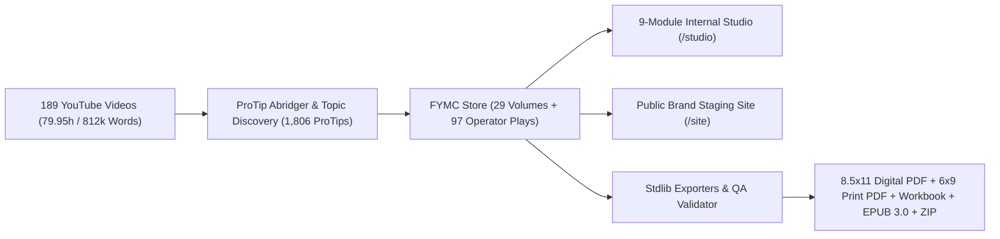

### Multi-Volume Store Contract

`PUBLISHED_VOLUME_IDS = ("vol-001-heir-hunting", "vol-002-surplus-funds-recovery", "vol-003-digital-product-empire", "vol-004-ai-powered-micro-saas", "vol-005-high-ticket-affiliate-marketing")` identifies the five built Founder Collection volumes exposed through the `/studio` and `/site` volume selectors; the constant does not open public deployment or paid sales.

`resolve_volume_slug(volume_id=None)` returns `vol-001-heir-hunting` for `None`, `""`, `1`, `"1"`, `"001"`, `"vol-001"`, `"vol-001-heir-hunting"`, or `"heir-hunting"`; `vol-002-surplus-funds-recovery` for `2`, `"2"`, `"002"`, `"vol-002"`, `"vol-002-surplus-funds-recovery"`, or `"surplus-funds-recovery"`; `vol-003-digital-product-empire` for `3`, `"3"`, `"003"`, `"vol-003"`, `"vol-003-digital-product-empire"`, or `"digital-product-empire"`; `vol-004-ai-powered-micro-saas` for `4`, `"4"`, `"004"`, `"vol-004"`, `"vol-004-ai-powered-micro-saas"`, or `"ai-powered-micro-saas"`; and `vol-005-high-ticket-affiliate-marketing` for `5`, `"5"`, `"005"`, `"vol-005"`, `"vol-005-high-ticket-affiliate-marketing"`, or `"high-ticket-affiliate-marketing"`. Booleans and every other value raise `ValueError("Invalid volume_id")`.

### Repository Map

* [`publishing/brand/brand_system.json`](publishing/brand/brand_system.json) — Official brand architecture, Concept B Owner-Approved Series Master, pricing tiers, COGS specs, and canonical release state.
* [`publishing/catalog/pipeline_29_candidates.json`](publishing/catalog/pipeline_29_candidates.json) — All 29 scored candidate volumes and all 97 canonical Track 01 / Track 02 plays.
* [`publishing/volumes/vol-001-heir-hunting/`](publishing/volumes/vol-001-heir-hunting/) — Upgraded 5-Layer Volume 001 structured manuscript, 12 deep chapters with all 5 mapped plays and forensic fallback matrices, 201 unique timestamped deep links, 8 diagrams, and 6 worksheets; 10 cover/mockup SVGs in the [Concept B art package](publishing/previews/concept_b/art/).
* [`publishing/volumes/vol-002-surplus-funds-recovery/`](publishing/volumes/vol-002-surplus-funds-recovery/) — 100% Built & QA-Verified Volume 002 (`10/10` Expanded Edition) structured manuscript (`62,159` words), 12 deep chapters with all 10 mapped Track 01 + Track 02 plays and forensic teardowns, 202 unique surplus-native timestamped deep links (`216` sentence-clean citations), 8 diagrams, and 6 Surplus Funds worksheets.
* [`publishing/volumes/vol-003-digital-product-empire/`](publishing/volumes/vol-003-digital-product-empire/) — 100% Built & QA-Verified Volume 003 (`10/10` Edition) structured manuscript (`59,252` words), 12 deep chapters with all 25 mapped Track 01 + Track 02 plays, 202 unique digital-product timestamped deep links (`216` sentence-clean citations across `72` videos & `63` channels), 8 diagrams, and 6 Digital Product worksheets, plus [Concept B exports](publishing/previews/vol-003-digital-product-empire/concept_b/).
* [`publishing/volumes/vol-004-ai-powered-micro-saas/`](publishing/volumes/vol-004-ai-powered-micro-saas/) — 100% Built & QA-Verified Volume 004 (`10/10` Expanded Edition) structured manuscript (`63,632` words), 12 deep chapters (`217` table rows across `34` tables) with all 27 mapped Track 01 + Track 02 plays, 201 unique AI Micro-SaaS timestamped deep links (`216/216` pure SaaS/AI/Billing citations across `99` videos & `85` channels), 8 diagrams, and 6 expanded AI Micro-SaaS worksheets (`5,389` words), plus [Concept B exports](publishing/previews/vol-004-ai-powered-micro-saas/concept_b/).
* [`publishing/volumes/vol-005-high-ticket-affiliate-marketing/`](publishing/volumes/vol-005-high-ticket-affiliate-marketing/) — 100% Built & QA-Verified Volume 005 (`10/10` Expanded Edition) structured manuscript (`70,333` words), 12 deep chapters (`422` table rows across `48` named-program matrices at `6.24` avg words/cell + `12` `INSIDER PRO-TIPS` callouts / `48` practitioner tactics) with all 35 mapped Track 01 + Track 02 plays, runnable Cloudflare Worker + D1 S2S reference & 90-day cohort walk, 214 unique High-Ticket Affiliate timestamped deep links across 189 distinct videos & 141 channels (`216/216` pure Affiliate/SEO/GEO/Attribution citations), 8 diagrams, and 6 expanded High-Ticket Affiliate worksheets (`6,195` words), plus [Concept B exports](publishing/previews/vol-005-high-ticket-affiliate-marketing/concept_b/).
* [`publishing/previews/vol-002-surplus-funds-recovery/concept_b/`](publishing/previews/vol-002-surplus-funds-recovery/concept_b/) — Volume 002 Concept B preview/export package, including 10 `VOLUME 002` cover/mockup SVGs, the `86 / 100` scorecard, and the fee waterfall plate.
* `src/fymc/volume_002_*.py` in [`src/fymc/`](src/fymc/) — Volume 002 production source modules.
* [`publishing/previews/`](publishing/previews) — Reproducible Concept A, Concept B, and Concept C export packages (`digital_pdf.pdf`, `print_6x9_pdf.pdf`, `workbook_pdf.pdf`, `book.epub`, `bundle.zip`, and `art/*.svg`).
* [`src/fymc/`](src/fymc) — Core publishing platform (`brand_and_catalog.py`, `scorecard_engine.py`, `design_concepts.py`, `cover_and_mockups.py`, `diagrams_engine.py`, `interior_templates.py`, `volume_001_manuscript.py`, `volume_001_citations.py`, `exporters.py`, `qa_validator.py`, `http_routes.py`).
* [`src/static/studio.html`](src/static/studio.html) & [`src/static/site.html`](src/static/site.html) — 9-module Internal Publishing Studio (`/studio`) and Public Brand Staging Storefront (`/site`).
* [`ADVANCED_AGENT_HOW_TO_REPORT.md`](ADVANCED_AGENT_HOW_TO_REPORT.md) & [`VIDEO_BY_VIDEO_COMPENDIUM.md`](VIDEO_BY_VIDEO_COMPENDIUM.md) — 8-domain operational manual and 189-video extractive compendium.
